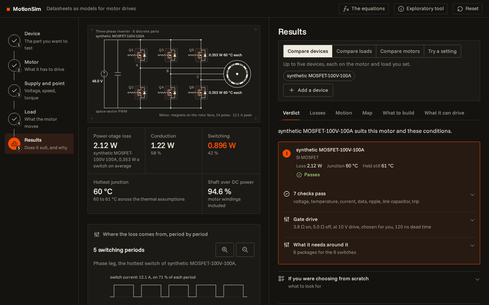
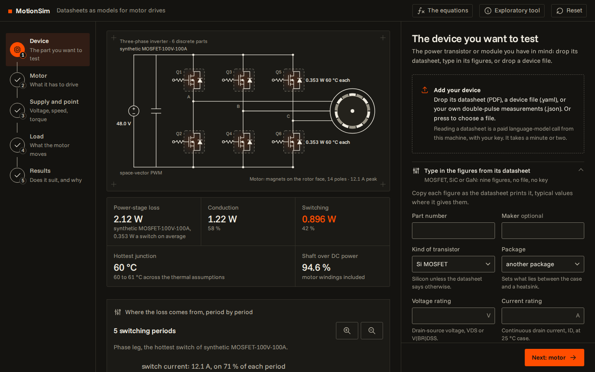
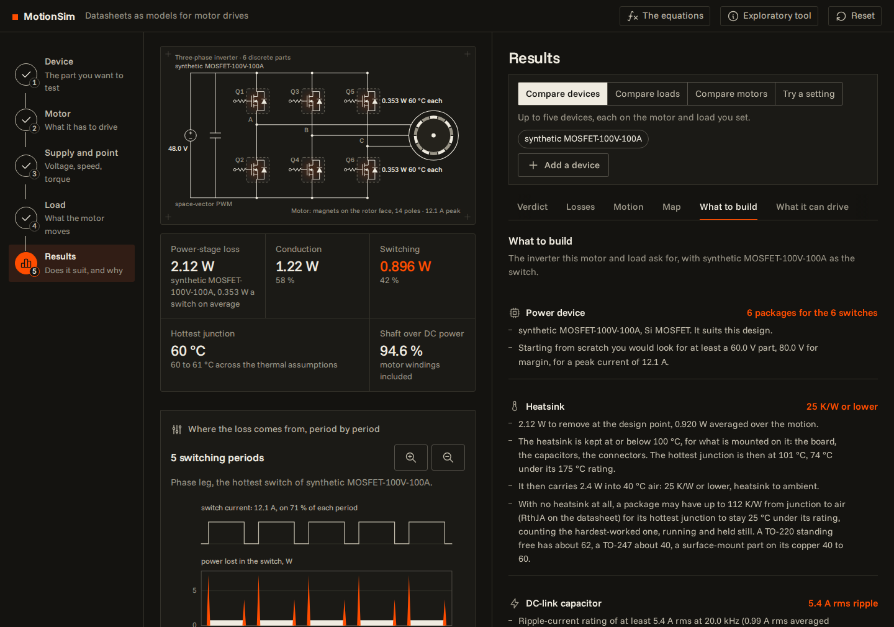
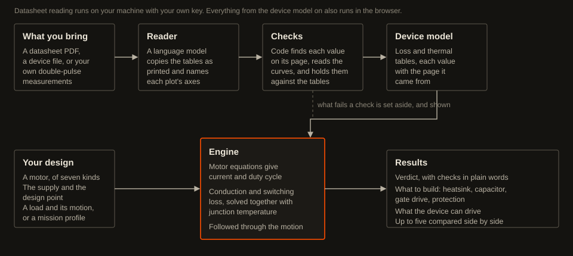

# MotionSim

Bring a power transistor's datasheet, or a dozen figures typed from it, your motor and your load. See what the power stage loses, how hot it gets, and whether the part suits the job.

MotionSim is a web page with a loss and temperature engine behind it. It works from any vendor's datasheet, shows the equations it uses, and says in every result what the data supports and what it leaves out. It answers two questions: what inverter a load needs, and what load a device can drive.

Live page: https://yannickyamo.github.io/MotionSim/

No browser needed: the same five steps run from a terminal with one command, `motionsim design run design.yaml`, and a coding agent can drive it that way. See [From the terminal, or driven by a coding agent](#from-the-terminal-or-driven-by-a-coding-agent).



The live page runs the engine in your browser. Type in a transistor from its datasheet, bring a device file, or try one of two made-up parts: a 100 V MOSFET and a 600 V IGBT. Nothing you enter leaves your browser. It does not read datasheet PDFs: that needs your own key and a local install, as below.

**Status: early, and exploratory.** It has been checked against formulas, an independent numerical integration and one vendor's own simulator on one part (total loss 5 to 13% high). Against the one measured inverter loss found in public, a 48 V reference design, it is 10 to 31% low on a measurement that includes the board's own resistance. [docs/VALIDATION.md](docs/VALIDATION.md) has the numbers; [docs/LIMITS.md](docs/LIMITS.md) says where it falls short.

## Who it is for

People with a motor to drive and a power stage to choose, who are not power-electronics specialists: hobbyists, and early-stage teams in robotics and similar fields.

## Why

Every semiconductor vendor has a loss calculator, and each one knows only that vendor's parts. Comparing an IGBT from one vendor with a MOSFET from another means building the models yourself, usually by typing a datasheet into a simulator by hand.

MotionSim starts from the datasheet itself, or from your own measurements. Each value in a device model records the page it came from, and each result says what it rests on.

## What you do with it

Five steps on one page, with the power stage drawn on screen the whole time:

1. **The device.** Type in a dozen figures from a transistor's datasheet (ratings, on-resistance, gate and output charge, thermal resistance), drop its datasheet (PDF) or a device file, or bring your own double-pulse measurements. A figure that cannot be right, such as an on-resistance in the wrong unit, is refused where it sits. Nothing is listed that you did not bring.
2. **The motor.** Seven kinds: permanent-magnet (magnets on, set into or buried in the rotor), reluctance, induction, brushless DC, brushed DC with a magnet or a series field, and stepper. The kinds that suit your device's voltage come first, and one is marked as the usual choice: that is a default by voltage and by how many switches the package holds, not a ranking of motors.
3. **The supply and the design point.** Voltage, speed, torque, switching frequency (up to 10 MHz, for GaN), devices in parallel. And the cooling: a heatsink at a temperature you know, a heatsink in air from its K/W figure, or no heatsink, with each part standing in the air or all of them soldered to one board, where they warm each other.
4. **The load.** Pick a kind (fan, compressor, robot joint, vehicle, washer drum, positioning axis, power tool) sized to your motor, or bring a mission profile as a CSV file. Each kind of motor is offered the loads it is used for: a reluctance motor a pump or a compressor, not a washer drum or a wheel. Choose how the drive starts the motor.
5. **The results.**
   - A verdict with plain-language checks, and what the part needs around it. A caution on the data means the operating point is outside what the datasheet gives, for a loss that matters there. A gate drive and a dead time you did not give are chosen, counted and stated, and the dead-time advice says what a firmware default of 500 ns would cost.
   - Conduction and switching loss, and junction temperature as a range where values are assumed.
   - Temperature through the whole motion, the motor current, and a life estimate under thermal cycling.
   - A speed-torque map, in the motor's units or the load's.
   - **What to build**: the heatsink (kept to 100 °C unless you say otherwise: what is mounted on it gives out before a junction does), the DC-link capacitor and the ripple current it must carry, the gate drive, and the protection the design needs, on one sheet.
   - **What it can drive**: the question turned round. The torque the device holds at each speed, how that moves with switching frequency and heatsink temperature, and how much heavier your load could be.
   - Up to five devices, loads or motors compared side by side, or one setting (switching frequency, supply voltage, heatsink or air temperature, devices in parallel) tried at two to five values, each added as a column. The table gives each one's verdict, its margin to the junction limit running and held still, and every loss and temperature of the hottest switch position: the switch conducting, turning on and turning off, the diode, each junction's peak, average and swing, the case, and what the switching does to the link capacitor and the motor current. Losses too close to tell apart are marked level, and devices compared on unlike data are said to be.
   - A setup you can save to a file, and the whole result as a report: a PDF, or a Markdown file to keep or to hand to a coding agent.





An input that cannot work is refused with the reason and what to change. The equations behind every figure are one press away. What you enter is kept in your browser from one visit to the next; Reset, at the top right, clears it.

## Install and run

To read your own datasheets, run MotionSim on your own machine. There is no account, and nothing is sent to this project.

```
git clone https://github.com/yannickYamo/MotionSim.git
cd MotionSim
python -m venv .venv && . .venv/bin/activate
pip install .
motionsim serve
```

The page opens at `http://127.0.0.1:4310/`. It answers only requests from your own machine. It needs Python 3.11 or later.

The same install gives the `motionsim` command: `motionsim --help` lists what it does, and `motionsim design init` followed by `motionsim design run` takes a part from datasheet figures to a verdict without opening the page.

### Reading datasheets needs your own API key, and that is why it is local

Reading a datasheet PDF is done by a language model, and that is a paid call. MotionSim makes it from your machine, with your own Anthropic API key, straight to Anthropic. The project has no server of its own, keeps no key and sees none of your files.

```
export ANTHROPIC_API_KEY=your-key
motionsim serve
```

- The key is read from your environment each time the page starts. It is never written to disk, never sent to the page, and never leaves your machine except in the call to Anthropic.
- A datasheet takes a minute or two and costs about what a long chat message does. The page says so before it starts.
- What was read is saved beside the device model, value by value with its page number, so you can check it against the datasheet. Open "Check what was read" on any part.
- Without a key everything else works: a transistor typed in from its datasheet, device files, your own measurements, and the made-up parts.

Datasheets are their vendors' property. None is distributed here, and no device data ships with the project.

## Example

Without a datasheet or a key, from the command line:

```
motionsim simulate examples/synthetic_igbt_600v_30a.yaml --vdc 300 --irms 10 --m 0.9 --pf 0.85 --fsw 8000 --tsink 60
```

```
synthetic LINEAR-600V-30A (Si IGBT)
  switch   conduction    4.593 W
           turn-on       0.878 W
           turn-off      0.698 W
  diode    conduction    1.081 W
           recovery      0.282 W
  power-stage loss       45.19 W
  efficiency             98.18 %
  Tj switch  average      79.8 °C   peak   84.2 °C
  Tj diode   average      75.6 °C   peak   77.8 °C
  T case                  64.5 °C
  margin to Tj max        40.8 °C
  hottest junction        76.8 to 109.2 °C across the thermal assumptions
    - heating between chips computed for a generic module, construction not given: 0.19 K/W (0.00 to 0.79) per watt in each other chip
  data support        interpolated
  not modelled
    - losses use each chip's average temperature over the output period
```

The margin is counted from the top of the range.

With a datasheet of your own:

```
motionsim extract my_part.pdf -o my_part.observations.yaml
motionsim build my_part.observations.yaml -o my_part.device.yaml
motionsim serve --devices .
```

Or with a transistor typed in by hand, no key needed:

```
motionsim template device -o my_part.yaml      # fill in the figures from the datasheet
motionsim build my_part.yaml -o my_part.device.yaml
```

Everything the page does is also a command: `motionsim --help` lists them. To rank several parts on one motor from the command line:

```
motionsim propose a.device.yaml b.device.yaml --vdc 48 --motor examples/motor_robot_joint_pmsm.yaml \
    --fsw 20000 --tsink 50 --tdead 2e-7 --rpm 1000 --torque 1
```

A gate drive left open is chosen for each part, as on the page. `--parallel`, `--tmin` and `--tmotor` set devices in parallel, the shortest pulse and the winding temperature. In place of `--tsink`, cooling to air is `--tair` with `--rth-heatsink` (a heatsink's K/W), or with `--rth-ja` or `--no-heatsink` for none (add `--board-area` and `--copper` for parts soldered to one board). A dead time left open is filled in, as on the page.

## From the terminal, or driven by a coding agent

Every step of the page can be run from one file, with no browser and no server:

```
motionsim design init --device my_part.yaml -o design.yaml   # a design sized to the part
motionsim design run design.yaml --md report.md              # fit, verdict, motion, what to build, what it can drive
motionsim design run design.yaml --json                      # the same, for a program to read
```

`my_part.yaml` is a device file, or the figures typed from a datasheet (`motionsim template device`). A design may name up to five devices, which are compared at the design point and through the motion, and several motors under `motors:`, which are compared on one inverter; `--csv table.csv` writes the comparison as a table. The exit status says how it went: 0 the part passes, 3 it does not (at the design point, or through the motion), 2 the design cannot be run as written, with the reason and the figure at issue in the output.

`motionsim agent` prints a guide written for coding agents: the loop, the design file, what comes back, and what to do with a refusal. There is no service to host and nothing to register: an agent that can run a command can use the tool. [AGENTS.md](AGENTS.md) points to it.

## How it works



1. A language model copies the datasheet's tabulated values exactly as printed and says what each plot's axes mean. It produces no model values.
2. Deterministic code checks that every number appears on the page it was cited from, converts units, reads curve coordinates from the PDF's own drawing commands (or traces them when a figure is a picture), and checks each curve against the tables. What fails a check is set aside and shown.
3. The device model is built from what passed. Where a datasheet gives single points, the assumed shape is written into the model.
4. The engine averages conduction and switching loss over an output period and iterates until the junction temperatures agree with the losses. Motors are solved from their steady-state equations, and a motion is followed through the device's thermal network in time.

[docs/THERMAL_MODEL.md](docs/THERMAL_MODEL.md) explains the thermal part. The page's "The equations" button shows all of it.

## Why it was built

Choosing a power semiconductor usually means trusting each vendor's calculator for that vendor's parts, or building a model by hand. This project asks whether the datasheet itself can be the model, with the tool stating how far that data supports a design decision.

## How it compares

| | Vendor web tools | General circuit simulators | MotionSim |
|---|---|---|---|
| Parts covered | One vendor's | Any, if you build the model | Any, from its datasheet or a dozen typed figures |
| Model source | Not shown | Entered by hand | Recorded per value, with its page |
| Assumptions and gaps | Not shown | Not shown | Listed in each result |
| Accuracy | Calibrated on the vendor's own measurements | As good as your model | One public measurement, 10 to 31% low with the board's resistance in it; a range where data is missing |
| Control loop, other topologies | Some | Yes | No: motor inverters, steady state at each instant, with ripple at the switching frequency worked out from the switching sequence |
| Both directions | The load is given | The load is given | What a load needs, and what a device can drive |
| Comparing parts | Within one vendor | Any, model by model | Any vendors, with each part's test conditions beside it and a tie called a tie |
| Lifetime | Vendor's own cycling data | With your own model | A generic model, named as such |

The vendors' tools and the circuit simulators are ahead on accuracy and breadth. What MotionSim adds is the path from any datasheet to a result, in the open.

## More

- [docs/VALIDATION.md](docs/VALIDATION.md): every check, including the ones that fail, and the datasheets the reader has been tried on.
- [docs/LIMITS.md](docs/LIMITS.md): what it does not do, in order of importance.
- [docs/THERMAL_MODEL.md](docs/THERMAL_MODEL.md): what a datasheet's thermal resistance means and how the rest is computed.
- [docs/ROADMAP.md](docs/ROADMAP.md): what is planned.

The models follow from published physics and handbook material properties. Device data comes only from datasheets you supply. No vendor's internal data or models are used.

## Author

MotionSim is designed and maintained by Yannick Maurice.

## Disclaimer

MotionSim is an exploratory engineering aid. Its results are estimates built from datasheet values, stated assumptions and simplified models, and they can be wrong.

Do not rely on it alone to design, size or approve hardware. Power electronics can start fires, destroy equipment and injure or kill. Check every result against the manufacturer's data, verify by measurement on real hardware, and follow the safety standards that apply to your product. The authors and contributors accept no responsibility for any design error, damage, injury or loss arising from use of this software. See [DISCLAIMER.md](DISCLAIMER.md).

## Licence

Apache-2.0, which provides the software as is, without warranty and without liability.
