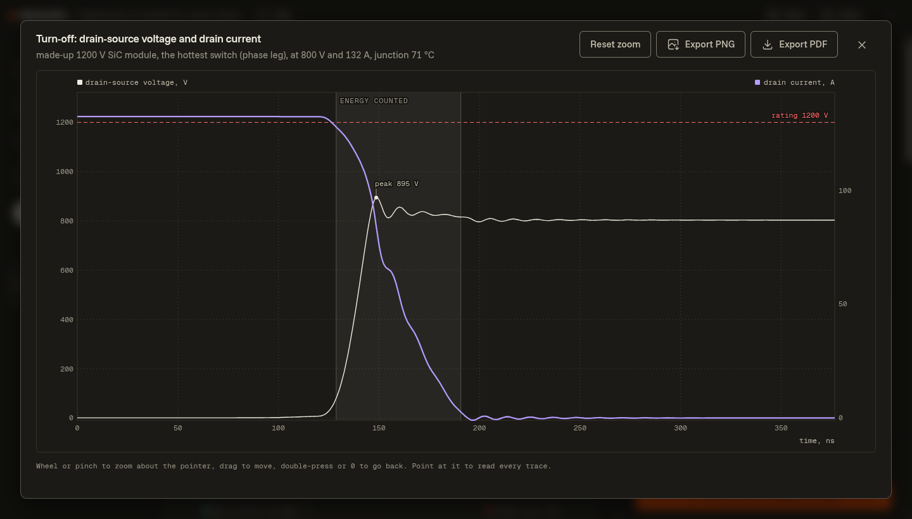
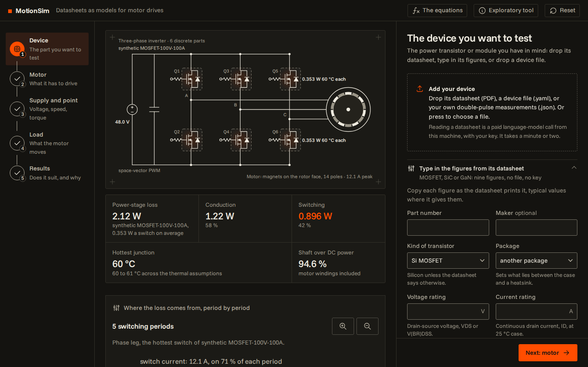
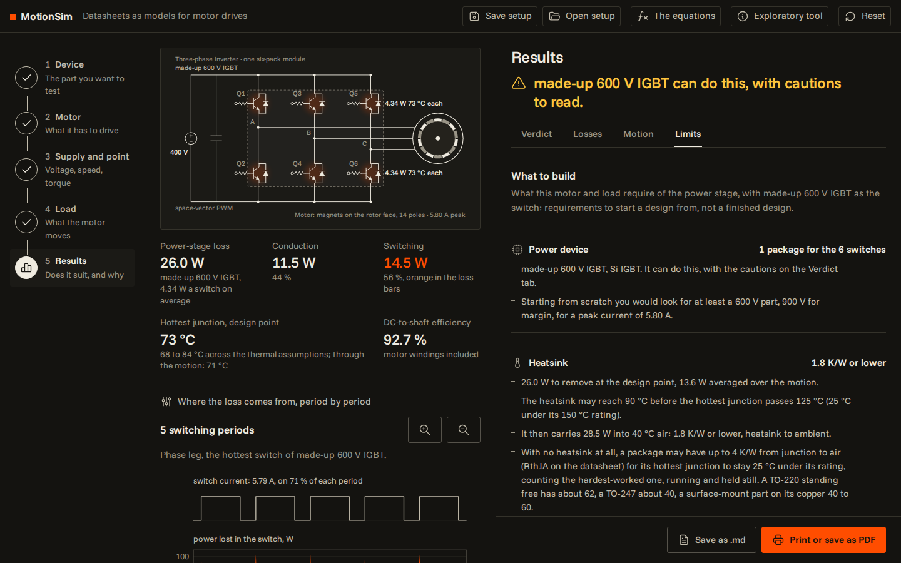
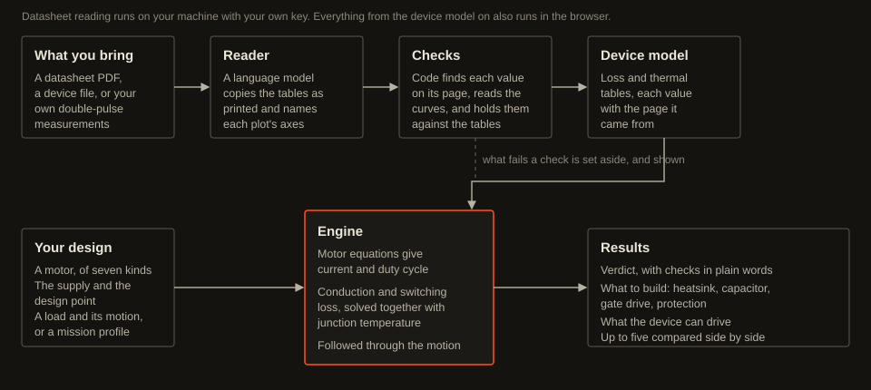

# MotionSim

[](https://github.com/yannickYamo/MotionSim/actions/workflows/ci.yml)

Compare any power transistor, from any maker, against your own motor and load, and take an answer into the design review that you can defend: what the part loses, how hot it runs, and what that rests on. Where the datasheet cannot settle the question, MotionSim tells you what to measure instead of guessing.

Choosing a part at the start of a design should take minutes, not a week.

Live page: https://yannickyamo.github.io/MotionSim/

**Reading a datasheet PDF needs your own model key.** Typing in a part's figures, opening a device file and trying the made-up parts all work on the live page, with no key and no account. To have a PDF read for you, run MotionSim on your own machine with an API key for a model you choose: Anthropic, OpenAI, Gemini, Grok, or one you host. The project ships no key and runs no server, so the call goes from your machine to your model and nowhere else. [How to set it up](#bringing-your-part-and-where-a-language-model-comes-in).

The device model is built from the part's own datasheet, so there is no vendor library to wait for, and an IGBT from one maker sits beside a GaN transistor from another on the same terms. Every value records the page it came from, the equations are on show, and every result says what the data supports and what it leaves out. It works in both directions: the power stage a load needs, or the load a part can drive. [docs/LIMITS.md](https://github.com/yannickYamo/MotionSim/blob/main/docs/LIMITS.md) says what it cannot read yet.

No browser needed: the same five steps run from a terminal with one command, `motionsim design run design.yaml`, and a coding agent can drive it that way. See [docs/GUIDE.md](https://github.com/yannickYamo/MotionSim/blob/main/docs/GUIDE.md).


The live page runs the engine in your browser. Type in a transistor from its datasheet, bring a device file, or try one of two made-up parts: a 100 V MOSFET and a 600 V IGBT. Nothing you enter leaves your browser. The first visit fetches about 26 MB (the Python runtime and its numerical libraries, 39 MB once unpacked); later visits use the browser's copy.

**Status: early, and exploratory.** It has been checked against formulas, an independent numerical integration and one vendor's own simulator on one part (total loss 5 to 13% high). Against the one measured inverter loss found in public, a 48 V reference design, it is 10 to 31% low on a measurement that includes the board's own resistance. [docs/VALIDATION.md](https://github.com/yannickYamo/MotionSim/blob/main/docs/VALIDATION.md) has the numbers; [docs/LIMITS.md](https://github.com/yannickYamo/MotionSim/blob/main/docs/LIMITS.md) says where it falls short.

Losses are worked out from the datasheet's typical values, so a part at the edge of its spread loses more and runs hotter than the figure shown; where the datasheet prints a maximum on-state voltage the result says by how much, and a junction-to-case resistance is taken at its maximum where one is printed.

## Who it is for

Robotics, mechatronics and hardware engineers who have a motor to drive and a power stage to choose, without first becoming power-electronics modelling specialists. Hobbyists can use it too.

## Why

Every semiconductor vendor has a loss calculator, and each one knows only that vendor's parts. It takes an operating point a specialist has to work out, and gives back one number with no word on what it rests on. Comparing an IGBT from one vendor with a MOSFET from another means building the models yourself, usually by typing a datasheet into a simulator by hand.

MotionSim starts from the datasheet itself, or from your own measurements. You give it a motor, a supply and a load, not a modulation index. Each value in a device model records the page it came from, and each result says what it rests on. Where the data cannot decide, it says so.

[docs/DESIGN_DECISIONS.md](https://github.com/yannickYamo/MotionSim/blob/main/docs/DESIGN_DECISIONS.md) goes through the problems it starts from, the decisions behind it and what each one costs.

## What you do with it

Five steps on one page, with the power stage drawn on screen the whole time:

1. **The device.** Type six figures from a MOSFET, SiC or GaN transistor's datasheet (an IGBT's from its first page and switching table), drop a datasheet or a device file (any supported part, IGBTs and modules included), or bring your own double-pulse measurements.
2. **The motor.** One of seven kinds, from its catalogue figures. It starts on the motor such a part usually drives, picked from the part's voltage, current, technology and package: a 1200 V, 100 A module starts on an induction motor, a 100 V, 2 A MOSFET on a small brushless one, each with a typical motor's real figures.
3. **The supply and the design point.** Voltage, speed, torque, switching frequency, how fast the edges may switch, and how the stage is cooled.
4. **The load.** An application, each run through its real duty from start-up to thermal steady state: a direct-drive washing machine, a vacuum cleaner, a ceiling fan, an air-conditioner compressor, a pump, a conveyor, a vehicle, a robot joint, a positioning axis or a power tool. Or a mission profile from a file.
5. **The results.** A verdict with plain-language checks, losses and junction temperatures, the temperature through the whole motion, one switching event zoomed in to nanoseconds, what to build around the part, what the part can drive, and up to five parts, loads or motors side by side, or one setting tried at several values.

A part passes, with any cautions listed, is ruled out, or is "undecided on this data" where the datasheet leaves the answer open, with what would settle it. An input that cannot work is refused with the reason and what to change. The equations behind every figure are one press away.

### Real applications, from start-up to steady state

A heatsink takes minutes to warm, so a few seconds of motion cannot tell you how hot a part runs. Each application runs its own duty for as long as it really lasts, with its own load physics, and says where every figure comes from:

| Application | What it runs | What it stresses |
|---|---|---|
| Washing machine, direct drive | a wash tumbling each way at 45 rpm, two rinses, a spin to 1400 rpm held 5 min: about 32 min on a 48-pole motor | each tumble reversal at a few hertz, where one switch carries the peak current for a long half-period |
| Vacuum cleaner | 80 000 rpm on a two-pole motor, run until steady, then a boost to 100 000 | the switching frequency against an electrical frequency of over 1 kHz |
| Ceiling fan | heavy blades brought up at the drive's current limit, then three speeds | seconds at the current limit to start |
| Air-conditioner compressor | a break-away and an open-loop start, a pull-down, a hold, and off, three times in an hour | a torque pulse every turn, strongest at low speed |
| Pump, conveyor | a soft or loaded start, then running until the junction is steady | the steady state itself |
| Vehicle | the class its motor's power suits, from a small cart to a car, on an 11-minute town ride with a hill and braking | the hill, and the energy braking returns to the supply |
| Robot joint, positioning axis, power tool | their short cycles, back to back for an hour | the peaks of each move |

The Motion tab draws the whole run in minutes with its phases named, marks the start-up's current and junction peak, says when each phase got steady, finds the worst swing of the junction, and gives the life that cycling leaves in years of the product's own use.


### One switching event, zoomed in

Press a spike on the chart of power lost in the switch and the turn-on and turn-off open through time, as an oscilloscope would show them: gate voltage, the switch's voltage and current, and power, with di/dt, dv/dt, the recovery current peak, the voltage overshoot and the ringing. They come from the datasheet's own figures through a model of the gate, the part's capacitances and the loop's inductance, matched to the energies the loss model counts. An IGBT's tail, a silicon MOSFET's recovery, a SiC MOSFET's fast edges and a GaN transistor's absent recovery each show as such parts do. Every figure assumed (loop inductance, gate resistors, driver levels) is named, with a box to give your own or a board layout to estimate it from. Each plot opens full screen to explore and save as a PDF.







[docs/GUIDE.md](https://github.com/yannickYamo/MotionSim/blob/main/docs/GUIDE.md) describes each step and every result in detail.

## Install and run

The live page needs no install. To read your own datasheets, or to work offline, run MotionSim on your own machine. There is no account, and nothing is sent to this project.

With [uv](https://docs.astral.sh/uv/), one line and nothing to clone:

```
uvx --from git+https://github.com/yannickYamo/MotionSim motionsim serve
```

Or from a clone, with pip:

```
git clone https://github.com/yannickYamo/MotionSim.git
cd MotionSim
python3 -m venv .venv && . .venv/bin/activate
pip install .                # the engine, the command line and the page
pip install ".[reader]"      # the same, with what it takes to read a datasheet PDF
motionsim serve
```

The page opens at `http://127.0.0.1:4310/`. It needs Python 3.11 or later, on Linux, macOS or Windows (there, `.venv\Scripts\activate`).

## Bringing your part, and where a language model comes in

Every kind of part simulates the same way once it is a device model: IGBT, silicon, SiC or GaN MOSFET, discrete or module. What differs is how the model gets made, and only one way needs a language model.

| Way to bring a part | On the live page | Needs a key | Parts it covers |
|---|---|---|---|
| A made-up part | Yes | No | A 100 V MOSFET and a 600 V IGBT module, to see what the tool does |
| Figures typed from the datasheet | Yes | No | MOSFET, SiC and GaN transistors, and IGBTs with their diode |
| A device file (`.device.yaml`) | Yes | No | Any part: made once, kept, shared, dropped onto the page |
| A datasheet PDF, read for you | No: on your own machine | Yes, your own | Any supported part, IGBTs and modules included |

**Reading a PDF with your own model.** The reading is done by a language model: yours, with your own key, or one you run yourself. The call goes from your machine straight to it: the project has no server, keeps no key and sees none of your files. That is why the live page cannot do it. With a maker's model it is a paid call, about what a long chat message costs.

```
pip install ".[reader]"
export ANTHROPIC_API_KEY=your-key
motionsim serve                 # then drop the PDF onto the page
```

or from the terminal, which leaves you a device file you can also drop onto the live page:

```
motionsim extract my_part.pdf -o my_part.observations.yaml
motionsim build my_part.observations.yaml -o my_part.device.yaml
```

Typing the figures in works from the terminal too, and needs no key:

```
motionsim template device -o my_part.yaml      # a MOSFET, SiC or GaN transistor
motionsim template igbt -o my_igbt.yaml        # an IGBT and its diode, from the figures printed hot
motionsim build my_part.yaml -o my_part.device.yaml
```

A figure marked optional may be left out: the tool takes one by a stated rule, says so in the results, and holds the verdict at a caution until the datasheet's is given.

The model only copies what the datasheet prints; ordinary code checks every value against its page and builds the model. Open "Check what was read" on any part to see it value by value.

Any of these reads a datasheet:

| Model | What to set |
|---|---|
| Anthropic (the one this tool was built and checked on) | `ANTHROPIC_API_KEY` |
| OpenAI | `OPENAI_API_KEY` and `MOTIONSIM_LLM_MODEL` |
| Google Gemini | `GEMINI_API_KEY` and `MOTIONSIM_LLM_MODEL` |
| xAI Grok | `XAI_API_KEY` and `MOTIONSIM_LLM_MODEL` |
| A model you host (Ollama, vLLM, llama.cpp, or any chat-completions service) | `MOTIONSIM_LLM_URL` and `MOTIONSIM_LLM_MODEL`, with `MOTIONSIM_LLM_KEY` if it wants one |

`MOTIONSIM_LLM_MODEL` is the name the service knows the model by. The model has to read pictures, for figures and scanned pages, and to answer in a set form. The first of these that is set is used, a service of your own before any maker's key.

```
export MOTIONSIM_LLM_URL=http://localhost:11434/v1      # a model on your own machine: nothing leaves it
export MOTIONSIM_LLM_MODEL=the-name-of-your-model
motionsim serve
```

Whatever reads, the same checks hold every value to the page it was cited from, so a weaker reader has more set aside, not more believed. Only Anthropic's model has been run on real datasheets here: the others are held to the interface they share, by a test that stands in for the service.


**Driving it from your own coding agent.** This needs no key of ours and works with any agent that can run a command. `motionsim agent` prints a guide written for one: the design file, the one command that runs every step, what comes back and what each exit status means. [AGENTS.md](https://github.com/yannickYamo/MotionSim/blob/main/AGENTS.md) points to it.

Datasheets are their vendors' property: none is distributed here, and no vendor's device data ships with the project.

## Example

Without a datasheet, a key or a clone, from the command line (`example` is the made-up 600 V IGBT module, `example-mosfet` the made-up 100 V MOSFET):

```
motionsim simulate example --vdc 300 --irms 10 --m 0.9 --pf 0.85 --fsw 8000 --tsink 60
```

```
made-up 600 V IGBT (Si IGBT)
  switch   conduction    4.602 W
           turn-on       0.888 W
           turn-off      0.708 W
  diode    conduction    1.079 W
           recovery      0.286 W
  power-stage loss       45.37 W
  efficiency             98.17 %
  Tj switch  average      80.9 °C   peak   85.4 °C
  Tj diode   average      76.9 °C   peak   79.1 °C
  T case                  64.5 °C
  margin to Tj max        45.3 °C
  hottest junction        76.9 to 104.7 °C across the thermal assumptions
    - heating between chips computed for a generic module, construction not given: 0.21 K/W (0.00 to 0.68) per watt in each other chip
  data support        interpolated
```

The margin is counted from the top of the range.

Everything the page does is also a command, one file runs every step (`motionsim design run design.yaml`), and the exit status carries the verdict, so a coding agent can drive it: `motionsim agent` prints the guide written for one, and [AGENTS.md](https://github.com/yannickYamo/MotionSim/blob/main/AGENTS.md) points to it. [docs/GUIDE.md](https://github.com/yannickYamo/MotionSim/blob/main/docs/GUIDE.md) has the commands.

## How it works



A language model copies the datasheet's values as printed and produces no model values. Deterministic code checks them, reads the curves and builds the device model, setting aside whatever fails a check. One engine averages conduction and switching loss over an output period and iterates until the junction temperatures agree with the losses; motors are solved from their steady-state equations, and a motion is followed through the thermal network in time. The page and the command line show what that engine gives and have no model of their own.

## For power-electronics and drives engineers

The same tool, in the terms you would use.

- **Device models.** IGBT, Si, SiC and GaN MOSFET, discrete or module. On-state from V_CE(I, T_j) or R_DS(on)(T_j) curves. Switching from E_on, E_off and E_rr against current and temperature, scaled with voltage, and E_on and E_off with gate resistance, along the datasheet's own figures where it has them; or, where only charges are given, from a gate-charge model through the Miller plateau with the Q_oss loss at hard turn-on; or, for a part with its gate drive built in that gives neither, from its rise and fall times. Double-pulse measurements replace the datasheet's switching energy. Thermal from Z_th(j-c) fitted as a Foster network; with no transient curve, a response computed from the package's copper and die heat capacity, as a low, typical and high range.
- **Loss engine.** Averaged over the output period for each switch and diode under sinusoidal, third-harmonic, space-vector and discontinuous PWM, block commutation and H-bridge drive. Dead-time and reverse conduction, recovery, and switching-frequency current ripple from the motor's inductance. Junction temperatures solved self-consistently with temperature-dependent loss, thermal runaway detected. Coupling between chips in a module and between packages on one board; case to heatsink as its own term.
- **Motors.** Steady-state dq models for surface, inset and interior PMSM with MTPA and field weakening; SynRM; induction under rotor-flux orientation; BLDC with 120° block commutation; brushed DC with a magnet or a series field; hybrid stepper with microstepping. Iron loss and saturation where given; magnet and copper temperature.
- **Switching transients.** A behavioural model of each edge: the gate charged through its resistance to the Miller plateau, a nonlinear output capacitance, the loop inductance ringing with it, the diode's recovery, an IGBT's tail current, each technology with its own shape. Calibrated to the loss model's energy at the operating point, and named indicative where it would have to be moved far to match. An edge speed limit (5 V/ns for a motor on a cable, 20 V/ns close to the drive, or none, held then by the driver's current and the part's channel) sets the gate resistors chosen.
- **Control.** The operating point field-oriented control settles to, not a simulated loop. Alignment and I/f start. The pulsed rating checked at the drive's current limit, or with an allowance for current-loop overshoot where none is given; the lowest sensorless speed from the dead-time and device-drop voltage error; a loss-minimising d-axis current with inverter loss included. Imported phase currents and duty cycles for anything a loop does beyond that.
- **Motion and reliability.** Load models (inertia, friction, fan law, gravity, vehicle drag and slope, a tumbling drum, a compressor's pulse once a turn, a break-away at standstill) behind a gear; duties in named phases, with run-ups at the drive's current limit and stretches held until the junction moves less than 0.5 K a minute; the heatsink followed from cold over minutes, with a usual heat capacity for its K/W where none is given; the junction's swing within one output period at low speed; rainflow counting and a LESIT-based power-cycling estimate; braking energy into the DC link; DC-link capacitor ripple current.
- **Validation.** Closed-form loss integrals, an independent numerical integration, datasheet curves against their own tables, one vendor simulator, one published measured inverter loss. [docs/VALIDATION.md](https://github.com/yannickYamo/MotionSim/blob/main/docs/VALIDATION.md).

## How it compares

| | Vendor web tools | General circuit simulators | MotionSim |
|---|---|---|---|
| Parts covered | One vendor's | Any, if you build the model | Any vendor's, from its datasheet where it gives enough, or a few typed figures |
| Model source | Not shown | Entered by hand | Recorded per value, with its page |
| Assumptions and gaps | Not shown | Not shown | Listed in each result |
| Accuracy | Calibrated on the vendor's own measurements | As good as your model | One public measurement, 10 to 31% low with the board's resistance in it; a range where data is missing |
| Control loop, other topologies | Some | Yes | No: motor inverters, steady state at each instant, with ripple at the switching frequency worked out from the switching sequence |
| Both directions | The load is given | The load is given | What a load needs, and what a device can drive |
| Comparing parts | Within one vendor | Any, model by model | Any vendors, with each part's test conditions beside it and a tie called a tie |
| Lifetime | Vendor's own cycling data | With your own model | A generic model, named as such |

The vendors' tools and the circuit simulators are ahead on accuracy and breadth. What MotionSim adds is the path from a datasheet to a result, in the open.

## More

- [docs/GUIDE.md](https://github.com/yannickYamo/MotionSim/blob/main/docs/GUIDE.md): every step, every result, the command line and coding agents.
- [docs/CASE_STUDY.md](https://github.com/yannickYamo/MotionSim/blob/main/docs/CASE_STUDY.md): four real datasheets from four makers, from PDF to verdict, with what was refused and why.
- [docs/DESIGN_DECISIONS.md](https://github.com/yannickYamo/MotionSim/blob/main/docs/DESIGN_DECISIONS.md): the problems it starts from, the decisions and their trade-offs.
- [docs/THERMAL_MODEL.md](https://github.com/yannickYamo/MotionSim/blob/main/docs/THERMAL_MODEL.md): what a datasheet's thermal resistance means and how the rest is computed.
- [docs/VALIDATION.md](https://github.com/yannickYamo/MotionSim/blob/main/docs/VALIDATION.md): every check, including the ones that fail, and the datasheets the reader has been tried on.
- [docs/LIMITS.md](https://github.com/yannickYamo/MotionSim/blob/main/docs/LIMITS.md): what it does not do, in order of importance.
- [docs/ROADMAP.md](https://github.com/yannickYamo/MotionSim/blob/main/docs/ROADMAP.md): what is planned.
- [CHANGELOG.md](https://github.com/yannickYamo/MotionSim/blob/main/CHANGELOG.md): what each version added. [SECURITY.md](https://github.com/yannickYamo/MotionSim/blob/main/SECURITY.md): what the tool handles of yours, and how to report a fault in it. [THIRD_PARTY.md](https://github.com/yannickYamo/MotionSim/blob/main/THIRD_PARTY.md): what it ships and loads that is not ours.

To work on the code, or to report a figure you think is wrong: [CONTRIBUTING.md](https://github.com/yannickYamo/MotionSim/blob/main/CONTRIBUTING.md). To cite it: [CITATION.cff](https://github.com/yannickYamo/MotionSim/blob/main/CITATION.cff).

The models follow from published physics and handbook material properties. Device data comes only from datasheets you supply. No vendor's internal data or models are used.

## Author

MotionSim is designed and maintained by Yannick Maurice.

## Disclaimer

MotionSim is an exploratory engineering aid. Its results are estimates built from datasheet values, stated assumptions and simplified models, and they can be wrong.

Do not rely on it alone to design, size or approve hardware. Power electronics can start fires, destroy equipment and injure or kill. Check every result against the manufacturer's data, verify by measurement on real hardware, and follow the safety standards that apply to your product. The authors and contributors accept no responsibility for any design error, damage, injury or loss arising from use of this software. See [DISCLAIMER.md](https://github.com/yannickYamo/MotionSim/blob/main/DISCLAIMER.md).

## Licence

Apache-2.0, which provides the software as is, without warranty and without liability.
