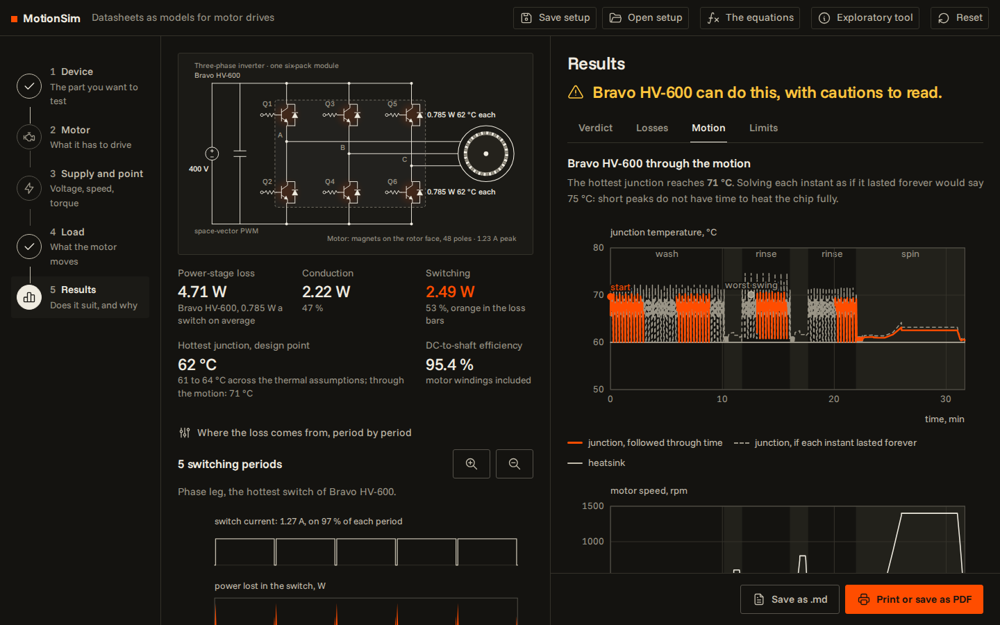
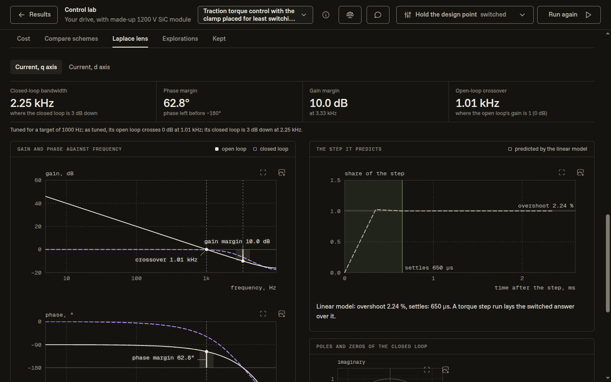

# MotionSim

[](https://github.com/yannickYamo/MotionSim/actions/workflows/ci.yml)

MotionSim is an open-source simulator for motor drives. Give it a power transistor from any semiconductor manufacturer, a motor and a load, and it tells you what the part loses, how hot it runs and whether it holds. One physical model covers the whole drive: the switching edges, the losses and the junction temperature, the mains front end, the motor, and the control loop down to its C code.

[Try it in your browser](https://yannickyamo.github.io/MotionSim/): nothing to install, no account, and nothing you enter leaves the page.


## Everything in one place

A drive is usually designed in pieces: a loss calculator from each semiconductor manufacturer, a circuit simulator for the stage, a control toolbox for the loop, and a spreadsheet to hold them together. Each has its own model, and none knows what the others assumed.

MotionSim is one tool and one simulation, from the circuit to the code:

- **Choose the part.** Any manufacturer's transistor, modelled from its own datasheet and compared on your duty.
- **Design the stage.** Losses, junction temperatures, gate drive, DC link and the mains front end.
- **Match the motor.** Seven kinds of motor, each run through its real load from start-up until the heatsink is warm.
- **Find the best control.** Twenty-four schemes, tuned for your motor, simulated switch by switch and compared on what they cost the power stage.
- **Export the code.** The control law as C, checked against the simulation, for your microcontroller.

Change one figure and every answer follows, because it is the same model all the way down.

## The infrastructure

One engine carries a design from the datasheet to the microcontroller. Each layer feeds the next, so a change anywhere moves every answer.

| Layer | What it does |
|---|---|
| **Device models** | Built from the part's own datasheet, each value with its page. IGBT, silicon, SiC and GaN, from any manufacturer, on the same terms. |
| **Loss and thermal engine** | Conduction, switching and junction temperature, solved together, through the application's real duty from start-up until the heatsink is warm. |
| **Front end** | The stage between the mains and the DC link, chosen for the design and counted in its losses. |
| **Control lab** | Twenty-four control schemes, tuned for your motor and simulated switch by switch. |
| **Export** | The control law as C, proved against the simulation, for the microcontroller you pick. |

It runs where you work: in the browser with nothing to install, on your own machine for your own datasheets, from a terminal, or driven by your coding agent.


## The journey

Five steps, one page, the power stage drawn on screen the whole time.

1. **The part.** Drop a datasheet, type a few of its figures, or pick an example.
2. **The motor.** Proposed from the part, yours to change.
3. **The supply.** A battery, a DC supply or the AC mains.
4. **The load.** A washing machine, a compressor, a vehicle, a robot joint, or your own profile.
5. **The answer.** Passes, ruled out, or undecided on this data, with what limits the part and what to change.

From there, open the control lab, close the loop and take the code.

### One design, start to finish

*A 1200 V SiC module, an eight-pole interior-magnet motor, an 800 V battery: can it drive an electric car, and what is the best way to control it?* The part is made up; every figure and graph below is the tool's own.

**1. The verdict.** Passes. At 4500 rpm and 156 N·m the six switches lose 369 W, 220 W of it in switching, at 98.4 % efficiency with the motor's windings. The hottest junction is 82 °C, at standstill, and the part would carry 1.74 times this load.

**2. The drive cycle.** Town, main road, a hill, and town again. The junction is followed through all of it, with the worst swing marked, and braking puts 3.73 MJ back in the battery.



**3. One switching edge.** Press a spike on the loss chart and the turn-off opens as an oscilloscope would show it: 132 A cut off, the voltage overshooting to 895 V on an 800 V link, then ringing out. The turn-on sits beside it, with di/dt, dv/dt and the energy of each.


**4. The control.** The control lab opens on torque control with least current and field weakening, every gain tuned for this motor, and runs it switch by switch. It passes, and points at the switching loss: a modulation that clamps each leg at its current peak would cut it.


**5. A better scheme.** Pick the traction scheme with the clamp placed for least switching loss and run again: 255 W in place of 369 W, the switching loss halved to 113 W and the junction 4 K cooler, with the current's distortion going from 1.77 % to 2.24 %.

**6. The loop, in frequency.** The Laplace lens gives the same loop its Bode plot, margins, step and poles: 62.8° of phase margin, 10 dB of gain margin, a 2.25 kHz bandwidth.



**7. The code.** Export the scheme as C, with a replay that checks it against the run.

## Outcomes

- **A part chosen on your own duty.** Up to five parts, from any manufacturers, side by side.
- **An answer you can stand behind.** Every figure opens on its equation and its datasheet page. Where the datasheet cannot settle it, you are told what to measure.
- **Thermal trouble found before the prototype.** The hottest moment of the real duty, and the life that cycling leaves.
- **A drive, not only a part.** The front end, the tuned control and the C that runs it, from the same design.

## Built for AI agents

MotionSim runs an MCP server beside the page. Connect Claude Code, or any MCP client, and your agent works on the same design you see:

```
claude mcp add --transport http motionsim http://localhost:4310/mcp --header "Authorization: Bearer <code>"
```

- **It reads what you see.** The design, the results, the scheme's blocks and gains, the loop margins and the traces of the last run.
- **It does what you do.** Chooses a part, changes a figure, switches the scheme, retunes a gain, runs a test or a sweep, exports the report and the C.
- **You stay in control.** Every change shows on your page as it happens, with **Undo**, and is listed in the agent's activity.

Ask it to review the design, to tune the current loop for more phase margin, or to find the lowest-loss scheme. The server runs on your machine only. With no page at all, `motionsim agent` prints the guide for driving MotionSim from a terminal. See [docs/MCP.md](https://github.com/yannickYamo/MotionSim/blob/main/docs/MCP.md).

## Your own parts

The live page takes the few figures you type from a datasheet. To have the PDF read for you, and to open the control lab, run MotionSim on your own machine:

```
uvx --from git+https://github.com/yannickYamo/MotionSim motionsim serve
```

The datasheet is read by a language model you choose, with your own key, or by one you host. The project runs no server: your files go from your machine to your model and nowhere else.

From a terminal, with no datasheet and no key:

```
motionsim simulate example --vdc 300 --irms 10 --m 0.9 --pf 0.85 --fsw 8000 --tsink 60
```

```
made-up 600 V IGBT (Si IGBT)
  switch   conduction    4.602 W
           turn-on       0.888 W
           turn-off      0.708 W
  diode    conduction    1.079 W
           recovery      0.286 W
  power-stage loss       45.37 W
  efficiency             98.17 %
  Tj switch  average      80.9 °C   peak   85.4 °C
  Tj diode   average      76.9 °C   peak   79.1 °C
  T case                  64.5 °C
  margin to Tj max        45.3 °C
  hottest junction        76.9 to 104.7 °C across the thermal assumptions
    - heating between chips computed for a generic module, construction not given: 0.21 K/W (0.00 to 0.68) per watt in each other chip
  data support        interpolated
```

[docs/GUIDE.md](https://github.com/yannickYamo/MotionSim/blob/main/docs/GUIDE.md) has Docker, pip, every command, and how a coding agent drives it.

## How it compares

| | Manufacturers' web tools | Circuit simulators | MotionSim |
|---|---|---|---|
| Parts | One manufacturer's | Any, if you build the model | Any manufacturer's, from its datasheet |
| What you give | An operating point | A circuit | A motor, a supply and a load |
| Where the model comes from | Not shown | Entered by hand | Each value with its datasheet page |
| Assumptions and gaps | Not shown | Not shown | Listed in each result |
| Comparing parts | Within one manufacturer | Model by model | Any manufacturers, side by side |
| Accuracy | Calibrated on the manufacturer's own measurements | As good as your model | See below |

## How far to trust it

MotionSim is early and exploratory. The manufacturers' tools and the circuit simulators are ahead on accuracy. Against one manufacturer's simulator on one part, total loss came out 5 to 13% high. Against four published reference designs, loss came out low (10 to 31% on one board) and a board with no heatsink ran up to about twice as warm as measured. Losses use the datasheet's typical values, so a part at the edge of its spread runs hotter than shown.

[docs/VALIDATION.md](https://github.com/yannickYamo/MotionSim/blob/main/docs/VALIDATION.md) has every check, including the ones that fail. [docs/LIMITS.md](https://github.com/yannickYamo/MotionSim/blob/main/docs/LIMITS.md) says what it does not do.

## More

- [docs/GUIDE.md](https://github.com/yannickYamo/MotionSim/blob/main/docs/GUIDE.md): every step, every result, install, the command line and coding agents.
- [docs/CASE_STUDY.md](https://github.com/yannickYamo/MotionSim/blob/main/docs/CASE_STUDY.md): four real datasheets from four manufacturers, from PDF to verdict.
- [docs/DESIGN_DECISIONS.md](https://github.com/yannickYamo/MotionSim/blob/main/docs/DESIGN_DECISIONS.md): the problems it starts from and the trade-offs taken.
- [docs/CONTROL.md](https://github.com/yannickYamo/MotionSim/blob/main/docs/CONTROL.md), [docs/EXPORT_C.md](https://github.com/yannickYamo/MotionSim/blob/main/docs/EXPORT_C.md), [docs/MCP.md](https://github.com/yannickYamo/MotionSim/blob/main/docs/MCP.md), [docs/BOARD.md](https://github.com/yannickYamo/MotionSim/blob/main/docs/BOARD.md), [docs/THERMAL_MODEL.md](https://github.com/yannickYamo/MotionSim/blob/main/docs/THERMAL_MODEL.md): the control lab, the C export, coding agents, board files and the thermal model.
- [docs/ROADMAP.md](https://github.com/yannickYamo/MotionSim/blob/main/docs/ROADMAP.md), [CHANGELOG.md](https://github.com/yannickYamo/MotionSim/blob/main/CHANGELOG.md), [CONTRIBUTING.md](https://github.com/yannickYamo/MotionSim/blob/main/CONTRIBUTING.md), [SECURITY.md](https://github.com/yannickYamo/MotionSim/blob/main/SECURITY.md), [THIRD_PARTY.md](https://github.com/yannickYamo/MotionSim/blob/main/THIRD_PARTY.md), [CITATION.cff](https://github.com/yannickYamo/MotionSim/blob/main/CITATION.cff).

Device data comes only from datasheets you supply. Datasheets are their manufacturers' property: none is distributed here, and no manufacturer's internal data or models are used.

## Author

MotionSim is designed and maintained by Yannick Maurice.

## Disclaimer

MotionSim is an exploratory engineering aid. Its results are estimates built from datasheet values, stated assumptions and simplified models, and they can be wrong.

Do not rely on it alone to design, size or approve hardware. Power electronics can start fires, destroy equipment and injure or kill. Check every result against the manufacturer's data, verify by measurement on real hardware, and follow the safety standards that apply to your product. The authors and contributors accept no responsibility for any design error, damage, injury or loss arising from use of this software. See [DISCLAIMER.md](https://github.com/yannickYamo/MotionSim/blob/main/DISCLAIMER.md).

## Licence

Apache-2.0, which provides the software as is, without warranty and without liability.
