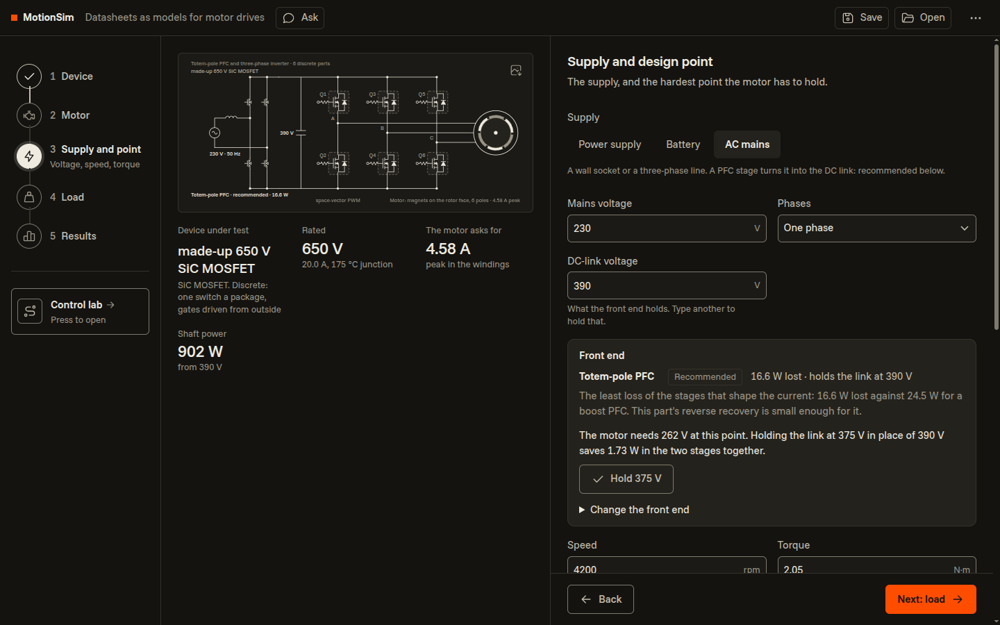

# MotionSim

[](https://github.com/yannickYamo/MotionSim/actions/workflows/ci.yml)

MotionSim is an open-source simulator for motor drives. Give it a power transistor from any semiconductor manufacturer, a motor and a load, and it tells you what the part loses, how hot it runs and whether it holds. It covers the whole drive, from the mains to the control code.

[Try it in your browser](https://yannickyamo.github.io/MotionSim/): nothing to install, no account, and nothing you enter leaves the page.


## The problem

Choosing a power transistor at the start of a motor drive takes about a week, and the answer is still hard to stand behind.

- **Every semiconductor manufacturer's calculator knows only its own parts.** To put an IGBT from one beside a SiC MOSFET from another, you build both models by hand.
- **It asks for what you do not have.** A modulation index and a power factor, when what you have is a motor, a supply and a load.
- **It gives one number.** Nothing on what the number rests on, or on what the datasheet left out.
- **It stops at one operating point.** A heatsink takes minutes to warm, and a washing machine's slow tumble is harder on the junction than its spin.

## The infrastructure

One engine carries a design from the datasheet to the microcontroller. Each layer feeds the next, so a change anywhere moves every answer.

| Layer | What it does |
|---|---|
| **Device models** | Built from the part's own datasheet, each value with its page. IGBT, silicon, SiC and GaN, from any manufacturer, on the same terms. |
| **Loss and thermal engine** | Conduction, switching and junction temperature, solved together, through the application's real duty from start-up until the heatsink is warm. |
| **Front end** | The stage between the mains and the DC link, chosen for the design and counted in its losses. |
| **Control lab** | Twenty-four control schemes, tuned for your motor and simulated switch by switch. |
| **Export** | The control law as C, proved against the simulation, for the microcontroller you pick. |

It runs where you work: in the browser with nothing to install, on your own machine for your own datasheets, from a terminal, or driven by your coding agent.


## The journey

Five steps, one page, the power stage drawn on screen the whole time.

1. **The part.** Drop a datasheet, type a few of its figures, or pick an example.
2. **The motor.** Proposed from the part, yours to change.
3. **The supply.** A battery, a DC supply or the AC mains.
4. **The load.** A washing machine, a compressor, a vehicle, a robot joint, or your own profile.
5. **The answer.** Passes, ruled out, or undecided on this data, with what limits the part and what to change.

From there, open the control lab, close the loop and take the code.

### One question, start to finish

*Can a 650 V SiC MOSFET run an air-conditioner compressor from a wall socket?* The part here is made up; the figures are the tool's own.

**1. Pick the part.** It opens on a compressor motor at 4200 rpm and 2.05 N·m, about 900 W at the shaft.

**2. Put it on the mains.** MotionSim recommends the stage between the socket and the DC link, and says why: a totem-pole PFC, 16.6 W lost against 24.5 W for a boost stage. The motor needs only 262 V, so it offers a lower link that saves another 1.73 W.



**3. Read the verdict.** Passes. The inverter loses 12.7 W, the hottest junction reaches 71 °C, 104 K under its rating, and the load could be 1.28 times heavier.

**4. Follow it through an hour.** A compressor starts, pulls down, holds and stops, three times an hour. The junction is drawn through all of it.


**5. Close the loop.** A compressor has no encoder, so the control lab picks a sensorless scheme, tunes it and runs it switch by switch with the PFC stage holding the link. The link holds within 5.3 V, and the lab offers a modulation that takes the switching loss toward 6.4 W.


Change any figure and every answer follows.

## Outcomes

- **A part chosen in minutes.** Up to five parts, from any manufacturers, side by side on your own duty.
- **An answer you can stand behind.** Every figure opens on its equation and its datasheet page. Where the datasheet cannot settle it, you are told what to measure.
- **Thermal trouble found before the prototype.** The hottest moment of the real duty, and the life that cycling leaves.
- **A drive, not only a part.** The front end, the tuned control and the C that runs it, from the same design.

## Your own parts

The live page takes the few figures you type from a datasheet. To have the PDF read for you, and to open the control lab, run MotionSim on your own machine:

```
uvx --from git+https://github.com/yannickYamo/MotionSim motionsim serve
```

The datasheet is read by a language model you choose, with your own key, or by one you host. The project runs no server: your files go from your machine to your model and nowhere else.

It also runs from a terminal, with no datasheet and no key:

```
motionsim simulate example --vdc 300 --irms 10 --m 0.9 --pf 0.85 --fsw 8000 --tsink 60
```

```
made-up 600 V IGBT (Si IGBT)
  switch   conduction    4.602 W
           turn-on       0.888 W
           turn-off      0.708 W
  diode    conduction    1.079 W
           recovery      0.286 W
  power-stage loss       45.37 W
  efficiency             98.17 %
  Tj switch  average      80.9 °C   peak   85.4 °C
  Tj diode   average      76.9 °C   peak   79.1 °C
  T case                  64.5 °C
  margin to Tj max        45.3 °C
  hottest junction        76.9 to 104.7 °C across the thermal assumptions
    - heating between chips computed for a generic module, construction not given: 0.21 K/W (0.00 to 0.68) per watt in each other chip
  data support        interpolated
```

[docs/GUIDE.md](https://github.com/yannickYamo/MotionSim/blob/main/docs/GUIDE.md) has Docker, pip, every command, and how a coding agent drives it.

## How it compares

| | Manufacturers' web tools | Circuit simulators | MotionSim |
|---|---|---|---|
| Parts | One manufacturer's | Any, if you build the model | Any manufacturer's, from its datasheet |
| What you give | An operating point | A circuit | A motor, a supply and a load |
| Where the model comes from | Not shown | Entered by hand | Each value with its datasheet page |
| Assumptions and gaps | Not shown | Not shown | Listed in each result |
| Comparing parts | Within one manufacturer | Model by model | Any manufacturers, side by side |
| Accuracy | Calibrated on the manufacturer's own measurements | As good as your model | See below |

## How far to trust it

MotionSim is early and exploratory. The manufacturers' tools and the circuit simulators are ahead on accuracy. Against one manufacturer's simulator on one part, total loss came out 5 to 13% high. Against four published reference designs, loss came out low (10 to 31% on one board) and a board with no heatsink ran up to about twice as warm as measured. Losses use the datasheet's typical values, so a part at the edge of its spread runs hotter than shown.

[docs/VALIDATION.md](https://github.com/yannickYamo/MotionSim/blob/main/docs/VALIDATION.md) has every check, including the ones that fail. [docs/LIMITS.md](https://github.com/yannickYamo/MotionSim/blob/main/docs/LIMITS.md) says what it does not do.

## More

- [docs/GUIDE.md](https://github.com/yannickYamo/MotionSim/blob/main/docs/GUIDE.md): every step, every result, install, the command line and coding agents.
- [docs/CASE_STUDY.md](https://github.com/yannickYamo/MotionSim/blob/main/docs/CASE_STUDY.md): four real datasheets from four manufacturers, from PDF to verdict.
- [docs/DESIGN_DECISIONS.md](https://github.com/yannickYamo/MotionSim/blob/main/docs/DESIGN_DECISIONS.md): the problems it starts from and the trade-offs taken.
- [docs/CONTROL.md](https://github.com/yannickYamo/MotionSim/blob/main/docs/CONTROL.md), [docs/EXPORT_C.md](https://github.com/yannickYamo/MotionSim/blob/main/docs/EXPORT_C.md), [docs/MCP.md](https://github.com/yannickYamo/MotionSim/blob/main/docs/MCP.md), [docs/BOARD.md](https://github.com/yannickYamo/MotionSim/blob/main/docs/BOARD.md), [docs/THERMAL_MODEL.md](https://github.com/yannickYamo/MotionSim/blob/main/docs/THERMAL_MODEL.md): the control lab, the C export, coding agents, board files and the thermal model.
- [docs/ROADMAP.md](https://github.com/yannickYamo/MotionSim/blob/main/docs/ROADMAP.md), [CHANGELOG.md](https://github.com/yannickYamo/MotionSim/blob/main/CHANGELOG.md), [CONTRIBUTING.md](https://github.com/yannickYamo/MotionSim/blob/main/CONTRIBUTING.md), [SECURITY.md](https://github.com/yannickYamo/MotionSim/blob/main/SECURITY.md), [THIRD_PARTY.md](https://github.com/yannickYamo/MotionSim/blob/main/THIRD_PARTY.md), [CITATION.cff](https://github.com/yannickYamo/MotionSim/blob/main/CITATION.cff).

Device data comes only from datasheets you supply. Datasheets are their manufacturers' property: none is distributed here, and no manufacturer's internal data or models are used.

## Author

MotionSim is designed and maintained by Yannick Maurice.

## Disclaimer

MotionSim is an exploratory engineering aid. Its results are estimates built from datasheet values, stated assumptions and simplified models, and they can be wrong.

Do not rely on it alone to design, size or approve hardware. Power electronics can start fires, destroy equipment and injure or kill. Check every result against the manufacturer's data, verify by measurement on real hardware, and follow the safety standards that apply to your product. The authors and contributors accept no responsibility for any design error, damage, injury or loss arising from use of this software. See [DISCLAIMER.md](https://github.com/yannickYamo/MotionSim/blob/main/DISCLAIMER.md).

## Licence

Apache-2.0, which provides the software as is, without warranty and without liability.
