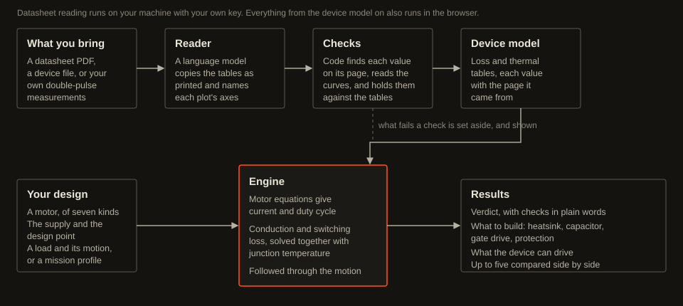

# Guide

How to use MotionSim in detail: the five steps of the page, the control lab, giving a board file, installing it, reading datasheets, the command line, and how it works inside. The [README](../README.md) is the short version. [DESIGN_DECISIONS.md](DESIGN_DECISIONS.md) says why it is built this way.

## The five steps

Five steps on one page, with the power stage drawn on screen the whole time:

**The first visit** asks one question. **Try a made-up part** brings a made-up 600 V IGBT onto step 1 with a washing machine's motor, point and load set, and a line saying what was assumed; Next leads through the motor, the supply and point and the load to the results. **Your part** takes a device file, a datasheet PDF, or its figures: paste a row or a table copied from the datasheet into the paste box, or type the few figures in the short table (symbol, value, unit). Tab goes from box to box and Enter adds the part, which then stands on step 1; a figure may be typed in the datasheet's own unit ("0.0045 Ω" in the mΩ box); a column or a row copied from a spreadsheet, pasted into a box, fills the boxes down from it. Units, commas and ranges are read ("2–4 V" is taken at 3 V, and says so); conditions such as "VGS = 10 V" are set aside. Everything not given is assumed and said with the verdict. Typed from the keyboard, the nine figures take about a minute and a half.

**What-if.** On the results, **Pin as A** keeps the figures as they are. Change one input anywhere and every key figure shows how far it moved from A, in its unit, with an arrow ("▲ 0.40 W"); the bar says what moved. **Pin this** makes the figures now the new A. With two or three parts on the page, **Recommend for me** names the part to choose and why, in figures, and the comparison opens with one line: "Choose X: … than Y".

1. **The device.** Type in nine figures from a MOSFET, SiC or GaN transistor's datasheet (ratings, on-resistance, threshold and plateau voltage, gate-source and gate-drain charge, thermal resistance), drop its datasheet (PDF) or a device file, or bring your own double-pulse measurements. A figure that cannot be right, such as an on-resistance in the wrong unit, is refused where it sits. Nothing is listed that you did not bring.
2. **The motor.** Seven kinds: permanent-magnet (magnets on, set into or buried in the rotor), reluctance, induction, brushless DC, brushed DC with a magnet or a series field, and stepper. The kinds that suit your device's voltage come first, and one is opened as the starting point: the kind the drives of your part's class run, picked by its voltage, its current, its technology and how many switches the package holds, with a line under it that says why ("1200 V, 100 A IGBT module: industrial drives of this size run induction motors"). A 1200 V part of 50 A or more starts on a 4-pole industrial induction motor, a smaller one on a servo motor; a 600 to 900 V part on a permanent-magnet motor of a compressor or fan under about 10 A, of a servo from 10 to 100 A and of a traction drive above; a part of 200 V or less on a small brushless DC motor under about 10 A and a permanent-magnet motor of an e-bike, a robot or a power tool above; a two-leg package at low voltage on a brushed motor. The motor has the figures of a typical one of its class: its poles, its rated speed, which is the design point's, a back-EMF at that speed of 80% of what the inverter gives from the supply, and a current limit just inside the part's rating. It is a template to begin from, not a recommendation of a motor, which the application decides: the kind, and every figure, can be changed, and what you pick or type stays when another part is brought in.
3. **The supply and the design point.** Voltage, speed, torque, switching frequency (up to 10 MHz, for GaN), devices in parallel. And the cooling: a heatsink at a temperature you know, a heatsink in air from its K/W figure, or no heatsink, with each part standing in the air or all of them soldered to one board, where they warm each other. On a heatsink you can say what lies under each package, grease or a pad, or give its case-to-heatsink figure where you have measured it; left alone it is worked out, with a range. In the gate drive's fold, whose face says it ("edges ≤ 5 V/ns"), the edge speed limit says how fast an edge the gate resistors the tool chooses may allow: a motor on a cable, 5 V/ns (the default); a motor close to the drive, 20 V/ns; or no limit, as fast as the part allows, where the turn-off overshoot, a gate driver's peak current (a usual one for the kind where none is given) and the current the part's channel can carry hold the resistors up. A faster edge loses less in switching, and stresses the motor's insulation and bearings and radiates more. The results say where the limit set a resistor, and a limit above 5 V/ns adds a caution to check the motor's insulation rating and cable length. A gate resistor you type is used whatever the limit. On the command line it is `--edge-limit cable|close|none`, and in a design file `edge_limit` under `conditions`.
   **Fed from the mains.** Press **AC mains** among the supply's three kinds (then its voltage, one phase or three) and the step works out the stage between the mains and the DC link: a card names the one recommended and why ("the least loss of the stages that shape the current: 14.4 W lost against 22.5 W for a boost PFC"), what it loses and the link voltage it holds. The stage is drawn on the schematic in front of the link, with its name and loss, and the control lab says the same chain under its block diagram (mains, front end, DC link, inverter). **Change the front end** lists the others for that mains with each one's loss: a rectifier and capacitor, a boost, an interleaved boost and a totem-pole stage on one phase; a six-pulse rectifier, a Vienna rectifier and an active front end on three. The link voltage is then the stage's; type your own and it is held instead, and where the motor needs less than the stage holds the card offers the lower link with what it saves in the two stages together. The results gain a line under the verdict and a Front end sheet under Limits: its losses, inductor, the capacitor's current with its share, the power factor, and the mains harmonics against the limit of IEC 61000-3-2 class A.
 In a design file it is `supply: mains` with `mains: {v: 230, f: 50, phases: 1}` and, where you want another stage than the one recommended, `front_end: {topology: boost}`; leave `v_dc` out of the conditions and the link is the stage's. `motionsim design run` works the front end out first and reports it, and `motionsim control` runs the link with it.

4. **The load.** Pick an application, each with a line saying what it is and how long it runs: a direct-drive washer's quick programme (wash, rinses and spin, about half an hour), a vacuum cleaner, a ceiling fan, a compressor that cycles on and off, a pump or fan, a conveyor, a vehicle's urban ride with a hill, the vehicle being the one its motor's power suits (a small cart, an e-bike, a scooter, a small car or a car), a robot joint, a positioning axis or a power tool. Each runs its own load and duty, with a start-up, and those held running are run until the junction is steady. A pump, a conveyor, a vehicle and the short cycles are sized to your motor; a washer, a vacuum, a ceiling fan and a compressor have a size of their own, and step 4 offers the motor such products usually have: pressed, it fills in the motor's figures and the design point you have not typed, and nothing you typed changes. Where your motor cannot run the application, it says why. Under the load, "Where these figures come from" gives the reason for each figure. Or bring a mission profile as a CSV file. Each kind of motor is offered the loads it commonly drives; any load can be entered by its figures, a duty's phases are listed with their repeats, and changing a stretch makes the motion those stretches alone. Choose how the drive starts the motor; an application picked brings its own start (a compressor's is sensorless). With a heatsink in air and no heat capacity given, a motion a few minutes long or longer takes the usual one for its K/W and says so.

   **Your duty, and what the part could carry.** Step 4 starts on your duty: the application's usual load and motion. Beside it, labelled as a proposal, is the heaviest load of the application that the part under test carries on your design ("This part carries up to 1.28× this load, limited by …"), and one press, "Use 1.28×", puts it in. The proposal is the application's own load, its inertia, friction, steady torque and masses grown together and its motion the same, made as heavy as it can be while every check of the motion passes and the junction stays at least 25 K under its rating (the margin below which the temperature check is a caution). It is found from the device's envelope (the most torque it holds at each speed), then confirmed by following the motion itself with the same checks the results show, and it names what stops it going further: the junction, the part's current, the motor's current limit, the motor's reach on the supply, or another check. Where the scheme recommended for the application starts the motor open loop (the sensorless appliances: washer, compressor, fan, drone and the like), the start is part of the proposal: the load is no heavier than the open-loop start lifts from rest, by the same rule that picks the scheme (the torque the drive's current limit makes, above what the load asks of a shaft leaving rest), and past that "the open-loop start" is named as what stops it. The junction is said with the band of the thermal assumptions and the margin from its top, so the figures add up: "peaking at 79 °C (up to 95 °C across the thermal assumptions), 80 K under its 175 °C rating". While it is worked out the usual load stands and the step says how far the search has got. Taken, it is tagged "proposal in use", and "Back to your duty" puts the application's usual load back, which stays your choice as the design moves; a figure you type is yours and is never replaced. Once the load is your own, the step says how it stands to the proposal, for instance "+18% torque over the proposal: the junction reaches 168 °C, 7 K under its 175 °C rating", and the Verdict tab of the results says the same. With the made-up parts the motor sized to the part (its current limit 0.9 times the part's rated current) is usually what stops the load first, long before the junction: the proposal says so, and a larger motor is the way to more load. `POST /api/load-proposal` (streamed at `/api/load-proposal/stream`) answers it for any design, kept for the design once worked out.
5. **The results.** They open on the verdict in one line, then four tabs: Verdict, Losses, Motion and Limits. Under the tabs, the comparison.
   - **Verdict**: a verdict with plain-language checks, and what the part needs around it. Where the temperature range crosses the rating the verdict is "undecided on this data", not a pass or a fail. It names the assumption that widens the range most (how the package is mounted, how its chips heat each other, or a missing transient curve) and what would settle it. So is a pass that rests on losses drawn beyond the datasheet's last point, when being as far off as they can be would undo it. A caution on the data means the operating point is outside what the datasheet gives, for a loss that matters there. A gate drive and a dead time you did not give are chosen, counted and stated, and the dead-time advice says what a firmware default of 500 ns would cost.
   - **Losses**: conduction and switching loss, and junction temperature as a range where values are assumed. A range says which assumption most of it comes from. The split of one switch position is one bar: conduction and switching named over it with their watts and shares, each part's share printed in its block, and its name, watts and share on pointing at it. The charts through time (on Motion) give every line's value at the instant pointed at.
   - **One switching event, zoomed in.** Under the chart of power lost in the switch, a press (or Enter) on a turn-on or turn-off spike opens that event through time: the gate voltage, the switch's voltage and current, and the power, for the turn-on and the turn-off side by side (one above the other on a phone). The wheel or a pinch zooms about the pointer, in proportion to how far it turns, once the pointer has rested on the plot for a moment (a page scrolled past it scrolls on); a drag pans, a double-click or 0 resets, + and − zoom by a fifth from the keyboard, and the time axis rescales from µs to ns. A press on a plot (or Enter, or its Voltage and Gate buttons) opens it full screen at its zoom, drawn at the screen's size, to zoom, pan and read the same way, with a crosshair that reads every trace; Export PDF there saves that plot at its zoom as a vector PDF for print, with its axes, a key of its traces, the figures read from the edge, the device, the operating point and what was assumed. Escape or Close goes back, keeping the zoom. Beside it: di/dt and dv/dt, the turn-on current peak from the other switch's recovery, the turn-off voltage peak and its overshoot over the supply, the ringing frequency, the rise and fall times and the energies, which are the chart's own. Every figure the tool had to assume is named on the plot ("Loop inductance assumed 20 nH (a TO-220 on a compact board): give yours") with a link to its box in Event detail: the loop, common-source and gate-loop inductances, the gate resistors and the driver's levels, a layout file or, on your own machine, the board's own design file ([Giving a board file](#giving-a-board-file)), and an estimate of the loop's inductance from its length, width and layer spacing. A figure you give replaces the assumption. Where the edge speed limit chose a gate resistor, the line says so with a link to raise the limit, and a note above the edges gives the event's own dv/dt and says what set it: the limit, with how much faster the part could switch without it, or, where the edges are well under the limit, the gate charge and the loss model's energy. The traces are coloured with their axis and their peak: voltage in bone, current in lilac, the gate in teal, power in orange. Where the datasheet gives switching times, the event's own in the same test are set beside them.
   - Where the control bears on the part: the pulsed current rating checked at the drive's current limit where the motor gives one, and with room for a current loop's overshoot where it does not; for a sensorless start, the speed below which the rotor cannot be read through this device's dead time and voltage drop; and, where the motor's iron loss is given, the d-axis current that loses least in motor and power stage together. In these five steps the control is its settled result, not a simulated loop: [LIMITS.md](LIMITS.md) says what that leaves out. On your own machine the control lab, below, simulates the loop itself.
   - **Motion**: temperature through the whole motion, the speed, torque and motor current, in minutes for a long duty, with its phases named in bands behind each chart. Marked on them: the start-up's junction peak and its current ("start current 0.45 A for 3.5 s"), where each phase run until steady got steady ("steady after 11 min 4 s"), and the worst swing within one output period or one turn. A press on a chart opens it full screen to zoom, read with a crosshair and save as a PDF, as the switching event's plots. Under the charts, how the heatsink was followed and why: from cold for a motion long beside its time constant, or at its mean temperature for a short cycle. Then a rough indicator of life under thermal cycling, in years of the application's own use: a generic model, named as one, which can be several times off.
   - A speed-torque map, in the motor's units or the load's, on the Losses tab behind Show the map.
   - **Limits**, in two parts. **What to build**: the heatsink (sized to a default target of 100 °C, which you can change; it is a design assumption, not a rating), the DC-link capacitor and the ripple current it must carry, the gate drive, and the protection the design needs, on one sheet.
     **What it can drive**: the question turned round. The torque the device holds at each speed, how that moves with switching frequency and heatsink temperature, and how much heavier your load could be.
   - **The comparison**: one table, a column each, beside the design. **+ Add** sets one more beside it: another device (made-up, typed in or from a file), another load, this motor with a change, or one setting (switching frequency, supply voltage, heatsink or air temperature, devices in parallel) at two to five values. One kind is compared at a time, up to five columns; adding another kind asks first, since it clears the table. Each column's own menu edits it, makes a device the design, or removes it, with Undo for a few seconds. On a phone the table slides sideways under its first column. The table gives each one's verdict, its margin to the junction limit running and held still, and every loss and temperature of the hottest switch position: the switch conducting, turning on and turning off, the diode, each junction's peak, average and swing, the case, and what the switching does to the link capacitor and the motor current. Losses too close to tell apart are marked level, and devices compared on unlike data are said to be.
   - A setup you can save to a file, and the whole result as a report: a PDF, or a Markdown file to keep or to hand to a coding agent.
   - Every chart, and the drawing of the power stage, saved as a PNG image from the button in its corner: the chart as it stands, zoom included, under its name and the part and point it is of, sharp enough for a report or a slide.

An input that cannot work is refused with the reason and what to change. The equations behind every figure are one press away. What you enter is kept in your browser from one visit to the next. Save and Open sit at the top right; the equations, Settings and Reset are in the "⋯" menu beside them, and Reset asks before it clears.

## The control lab

The control lab simulates the drive's control loop in time and says what a control scheme costs the power stage. It is on the local page only, for a permanent-magnet motor. The hosted page says where to find it. [CONTROL.md](CONTROL.md) has the model.

**Open it.** Under the results there is a section named Control. It says in one sentence which scheme was chosen for your design and why ("Cascaded speed and current control (servo) is chosen for this design: a speed is held against the load"), with one press: Open the control lab. Nothing of the lab is fetched until then. Left open, it opens again on your next visit.

**The scheme chosen, and why.** The scheme a design starts on is the one such products are built with, for the application of step 4 (or, for a made-up part whose load you have not picked, the application it is tried on), then checked against the physics of your design:

| Application | Starts on | Why |
|---|---|---|
| Robot joint | joint servo: speed and current cascade on an encoder, S-curve reference | holds its arm at standstill and follows a trajectory: only a measured angle does that |
| Positioning axis | speed and current cascade on an encoder | stops and holds on a position, down to standstill |
| Electric vehicle or e-bike | torque control, least current and field weakening | the pedal asks a torque and the road sets the speed, far into field weakening |
| Power tool | torque control on rotor position sensors (Hall sensors in practice) | started into the work and bogged down near a stall, loaded where no observer reads the rotor |
| Washing machine, compressor, vacuum cleaner, drone propulsion, ceiling fan, pump or fan, conveyor | speed control with no encoder: a back-EMF observer with a phase-locked loop, and an open-loop start with the current held and the angle imposed (I-f) | built with no rotor sensor for its cost or weight (a compressor sealed in its shell cannot carry one), and started from rest, under load where it is, before the observer has a back-EMF to read |
| None given | the speed and current cascade, or torque control on a motor with buried magnets (Lq at least 1.1 times Ld) | nothing is known of the load: a speed is held against it, and a buried-magnet motor is taken for a traction motor |

Then the physics. A scheme with no encoder is kept only where its open-loop start can lift the load: where the current limit's torque is no more than what the load asks of a shaft leaving rest, the design starts on a rotor sensor instead, except a compressor, which keeps it and is told a larger current limit is needed. A design that switches fewer than 30 times in a turn of its output needs a scheme sampled twice a carrier period or a current regulator designed in discrete time, and under 12 times the latter, by the same rule the verdict judges a run by: a speed scheme moves to its high-speed variant, a torque scheme to torque control with the discrete-time regulator, and the schemes with no encoder already are both. Every gain of the scheme chosen is worked out from your design's own figures (its inductances, resistance, flux, pole pairs, inertia, supply, switching frequency and load), and where one is missing, an inertia above all, the line under the choice says what was taken in its place and that the loops were tuned on it. The line says all of it. A clamped modulation for least switching loss is a lever the verdict offers where switching dominates the loss, not where a design starts. Seventeen more schemes can be picked in its place, each tuned for your design, and Choose for me (below) sets the closest of them beside it.

**Choose for me.** The scale button in the lab's head runs the recommended scheme, the one in the lab and up to three alternatives side by side, at once, on the same design, test and simulation, and opens Compare schemes. Each scheme is a column: its verdict, the current loop's phase margin, the current and speed loops' bandwidths, settling, THD, torque ripple and torque delivered, device loss, the junction at its worst, the blocks of its control law and its rate, and whether it needs a rotor sensor. The best of each row is marked "highest" or "lowest"; figures too close to tell apart (within 3 %, 2° of margin, 1 K) are a tie. Above the table, one line chooses, from the figures alone: a scheme that passes, delivers the torque the others do, and is best on the most of loss, junction, THD, margin, settling and torque ripple, with the figures it wins on ("Choose Back-EMF observer with a phase-locked loop because it passes with the widest phase margin (68.5° against 62.8°) and no rotor sensor"). Where the recommended scheme has no rotor sensor, a scheme that needs one is not chosen. Use it, or Use this scheme under any column, takes that scheme into the lab with its run. Where the choice is the scheme already in the lab but you have edited it, the line offers **Back to as tuned** instead: one press undoes the edits and brings the comparison's run with it.

**Learn.** Turn on Learn in the diagram's corner: each block carries a small corner mark, and pointing at a block says in one line what it does and which of its settings matter, with a way into its theory: the definition, the equations, and what raising each setting does. A speed or current regulator's inspector also shows the loop it closes, live: drag a gain's name sideways or step it with the arrow keys, and the loop's phase margin, bandwidth, overshoot and settling, with its gain and step plots, follow within a fraction of a second.

**Read a block.** The scheme is drawn as a block diagram, left to right as a control engineer draws it, with the way back underneath: sampling, the changes of frame, the regulators, the modulator, the stage, the motor. It can be panned, zoomed and fitted, and the keyboard reaches every block; on a phone the blocks are a list down the signal chain. Each block's face is a drawing of what it does, and it moves with the run: a regulator shows its error and the parts of its answer between the limit's rails, the modulator its carrier and the pulses it makes, the motor its rotor turning under the current. Press a block and the inspector beside the diagram gives its name and one-line definition, its mathematics, its inputs and outputs at the cursor's instant with their units, and its figures. Each figure sits in a box with its unit, the bounds it is held to and where its value came from ("pole-zero cancellation at ωc/2π = 1,000 Hz (a twentieth of the 20,000 Hz sampling rate): Kp = ωc·Lq"), with the way back to the value it was tuned to.

**The motor as simulated.** Press the motor and its inspector opens on how the engine simulates it. The controller is tuned on a rigid shaft and constant inductances; here the simulated motor can differ from that model, as a real one does, and the controller is not told. **Shaft to the load**: rigid, or twists, with its resonance (the frequency motor and load swing against each other at, as a frequency sweep or the gear's datasheet gives it), the rotor's share of the inertia, the damping and the play. **Iron**: linear, or saturating, its inductances falling with the current as is usual for its kind of motor. Both start as the controller's model. Once the shaft twists, the load's own speed ω_L is drawn on the rotor's chart, a speed step is judged at the load as well as at the rotor (the load's overshoot is its own finding, with the lever that helps at these gains), the cost lists the shaft's swing, the Laplace lens draws the speed loop round the two-mass shaft (its play left out), and a notch whose centre is not set takes the resonance given here. Under the verdict, one line says what was simulated beyond the controller's model. A setup saved carries it; every exploration and comparison is run on it.

**Run a test.** Seven tests: hold the design point, a torque step, a speed step, a start from standstill, a load step, a stall or a very low speed at high torque, and a window of the design's own motion (its peak torque or its fastest change). The test is one line in the lab's head, beside the scheme: press it to pick the test and its figures, filled in for your design, and how the stage is simulated, switch by switch (switched, the default) or by its mean voltage (averaged, faster and without ripple). Run the test is the orange button beside it (or Ctrl+Enter). A scheme that cannot be given a test says which scheme to take.

**Probe and play it.** Under the diagram is the scope, as in Simulink or PSIM: one strip for each quantity, on one time axis, each signal named as you would write it (ω_m, T_e, i_dq, ω*) with its value at the cursor. A run is drawn in it as far as it has come while it goes. The speed against what was asked, the torque against the load, the currents in the rotor's frame against their references and the phase currents are probed from the start. Every wire of the diagram is a probe: point at one to read what it carries at the cursor, press it (or Tab to it and press Enter) to add it to the scope or take it out; a probed wire carries a dot in its trace's colour and its value beside its name. Any other signal is added from the list under the strips, and a strip or a signal is taken out by its own cross. Point at a strip to move the cursor, drag across to look at a stretch, double-press for the whole run. Press Play: the cursor sweeps the run, every strip draws itself up to it, and the diagram's wires and the inspector's block move with it. Ripple, every point opens the last switching periods at full resolution with the legs' states. Under the scope are what the run cost, the step's rise time, overshoot and settling time, and the checks.

**What the run says of the design.** Right under the scope's head, every run (and every re-run after an edit) opens on one or two sentences: what is good, and what to improve and how. Under them are the findings they come from, each a figure with its number, marked Good, Could improve or Needs a change: the current and speed loops' phase and gain margins and crossovers against the sampling rate and each other, the step's overshoot, settling and error, the current's THD and ripple, the torque ripple, the split of the loss between conduction and switching, the junction's peak and swing against its rating, the carrier ratio, a limit held, an observer's angle error, and any check that did not pass. The thresholds are those of usual practice (a phase margin of 45 to 70°, the current loop near a twentieth of the sampling rate, the speed loop a decade below it, at most 10% overshoot, 5% THD, 25 K below the junction's rating, 40 K of swing). A finding to improve carries its lever: press it and the block's inspector opens at that setting, or the scheme named is taken. After an edit, the findings say what it changed against the scheme as tuned ("current-loop phase margin 62.7°→6.02°") and whether that is better or worse. Where a language model is set up for the datasheet reader, it phrases the same findings once more in plain words, checked to cite only their numbers and kept for the next time, with a quiet note that your model phrased it; the sentences shown first never wait for it.

**Edit a gain and read the cost.** A gain is changed in its box, or on the block itself: dragged sideways, or stepped with the arrow keys, a twentieth at a time, or a quarter with Shift held. A test already run is run again once the changing has paused. The headline of a run is what it costs the power stage: its loss and what the control moves of it (the current the switches carry, how often they commutate, the current they commutate, the ripple, the junction's peak and swing), each beside what the loss engine settles to at the design point, the run before, and a run you set aside to compare with. Gains the linear analysis finds unstable are run all the same, with a caution that names the pole: the run shows the oscillation. A current that runs away ends the run with a refusal.

**The Laplace lens.** A second view of the same scheme: each loop's gain and phase with its margins marked, its poles and zeros against the unit circle, the step it predicts beside the one simulated, and its transfer functions written out with your design's numbers. It follows the gains as they are edited, and the shaft as the motor's inspector sets it. It is a lens and not the answer: it knows no voltage limit, no ripple and no sensor, and where it and the run part, the run is right. A scheme with no transfer function (predictive, deadbeat, direct torque control) says why it has none.

**The exploration library.** Thirty-one questions worth asking of a drive, in five groups (losses, dynamics, sensing, robustness, thermal), each a sweep ready to run: "What would another switching frequency cost in loss and buy in ripple?", "How wrong can the inductance be before deadbeat control rings?". One that has nothing to show on your design says why. The answer is one small chart for each figure the sweep reads, with what the figures show said in words, and the published work the question rests on.

**When the drive trips.** The lab's test list has *A trip*. The drive runs at a speed and a torque (on a load that carries a weight, holds it still), trips, and the stage goes to its safe state: every gate off, the winding shorted, or by default shorted above the speed at which the magnet's voltage passes the DC link and switched off below it. The test says that speed. The scope adds the current pushed back into the DC link and the safe state over time. The verdict says how far the current swung and where it settled, what torque brakes the shaft, and whether the motor charged the link. Switched off above that speed, a motor turns generator into the link, which a supply that cannot take energy back sees as a rising voltage. Shorted, nothing reaches the link but the low switches carry the whole short-circuit current, which the junction finding reads. On a battery the link takes that current back as charge; on a supply that takes nothing back, the verdict says the voltage the link charges toward and sets it against the device's rating.

A robot joint, or any load that carries a weight, is tripped the way that matters for it: the arm held level, the shaft let go, the winding shorted, and a holding brake biting a little later. The verdict says how far the arm fell before the brake held it. Switched off, nothing brakes the fall; shorted, the winding does, in proportion to its speed. Give the brake's own torque and delay where they are known.

The trip test's *Cause* can be the encoder instead of the protection: the encoder freezes, and the drive trips once its own check, comparing the flux it reckons from its voltages and currents with the encoder's angle, sees it. Or a switch can fail open, the drive tripping once the phase currents show it. The verdict says how soon and how far the rotor turned unseen, or, under the speed where the back-EMF is too small to judge, that it never saw it: there only a second sensor or an injected signal does.

**No encoder at standstill.** For a motor whose two axes differ in inductance (set its magnets to *inset* or *interior* in the motor step, which then asks for *Ld* and *Lq*), the scheme list has *Speed control with no encoder, held at standstill by injection*. A small square wave of voltage reads the rotor's angle before any torque is asked, pulses tell the magnet's side, and the back-EMF observer takes over at speed. The scope draws the angle in use against the rotor's and the share handed over; the start test takes the angle the rotor stands at, and the speed step a load held through it. While injecting the current is held to what keeps the angle read close, so a heavy load waits for the observer to take over. The motor is simulated with saturating iron, as a real one with set-in magnets is; on linear iron the side cannot be told, the verdict says so and the drive does not start. The verdict also says when the iron's coupling turns the angle under load, with the compensation from the motor's own map as its lever; the *injection_coupling* card shows both side by side.

**How often the control is updated.** A fast stage often switches quicker than its controller can compute; a slow one leaves the current loop waiting on the carrier. The *control_rate* card runs the same small torque step with the control updated once every four carrier periods up to eight times a period, the gains tuned again at each, and shows the loop's crossover, the settling, the overshoot and the switching side by side. The rate is in the scheme's timing (`multi` with `per_carrier`, `every` with `carriers`) and in the exported parameter table.

**What the link's capacitor carries.** The stage draws its current from the DC link in pulses. Cost says, among its figures, the current the link's capacitor must carry, in amperes rms: the supply is taken to give the average and the capacitor the rest, which is the figure a capacitor is chosen by. It moves with the modulation, the load angle and the scheme, so two schemes compared can ask different capacitors.

**Currents read through shunts.** A low-cost drive reads its currents through resistors in the stage, not a sensor. On the sampling block's inspector, pick *Shunt sampling* in its place: three or two shunts under the low switches, or one in the DC link, with the window the amplifier needs and the timer's shift. The run then draws phase a as read beside the true one, Cost says in how many periods a phase could not be read and how far the reading is off, and the verdict says when the shunts miss too often and what to change. The two shunt cards compare each choice against a sensor, and one shunt with the shift and without.

**Keeping schemes and runs.** A scheme or a run is saved under a name, listed, brought back and taken away. They are kept in a small store on your machine (a file in MotionSim's folder), so they outlast the browser; this needs the `app` extra, which Docker has. A scheme can also be saved as a file of JSON, which is the shape `/api/control/run` takes as `scheme`.

**Export C code.** Under the verdict, next to the lab report. It writes the scheme, as tuned or edited, as portable C (a header and a source, C99 that compiles as C++). It compiles the C here and replays the run through it, wire by wire, and gives you the zip. `motionsim control export-c design.yaml --scheme foc_servo -o law.zip` does the same from the terminal. [EXPORT_C.md](EXPORT_C.md) says what is covered, what the replay shows and what it does not.

**Port it to a microcontroller.** Once the replay passes, the export's result offers **Port to a microcontroller**: pick a chip from the list (STM32G4, STM32F4, C2000 F28004x, C2000 F2837x, MCX A, MCX N, i.MX RT1170, dsPIC33CK, SAM E70, RA6T2, ESP32-S3, RP2350) or type any part number, then **Make the port**. A part number of a listed family (STM32G474RE) takes the family's profile. Any other chip is profiled by the model and marked *unverified profile*. The peripheral code (the PWM timer, the ADC trigger, the interrupt that calls the law, the registers it uses) is written by the language model set up for the datasheet reader, with your key. That is a paid call, made only when you press. The law itself is the one the replay proved, and the port calls it without changing it. Where `docker compose --profile firmware up` is running, the port is compiled for the chip and the result gives its size and warnings. The result lists the files, whether the port compiled, and what was checked and what was not. A port is at best *compiles / not run on hardware*. The coding agent's `export_port` tool does the same. [EXPORT_C.md](EXPORT_C.md#the-port-to-a-microcontroller) has the whole of it.

### A drive fed from the mains: two controls on one link

With the supply set to Mains, every run in the lab carries the DC link: the front end's own control (a slow loop that holds the link, a fast one that shapes the mains current) is simulated on what the motor's control drew, and the link's voltage and the power drawn from the mains are drawn under the test's charts. The two controls are tied by default: the front end is told the power the motor is about to draw, so the link does not have to fall before it answers a load step. The verdict says what the link did (held, a sag, braking that charges it toward the device's rating, its ripple at twice the mains) and, where a load's power swings and the tie passes the swing to the mains current, offers the other way: each on its own, the capacitor taking the swing. The choice sits with the front end on step 3. Two explorations compare tied against not, and the link capacitor at all, half and a quarter. **Export as C** then carries the front end's controller beside the motor's, in `front_end/`, replayed against its own simulation.

### The control lab from the command line

`motionsim control` asks the same engine from a terminal, for a design file as `motionsim design run` takes it. `--json` prints each answer whole. The examples below are for `motionsim design init --device example-mosfet -o design.yaml`, the made-up 100 V MOSFET on its 48 V robot joint.

The scheme chosen, the others and the tests:

```
$ motionsim control presets design.yaml
Chosen for this design: servo_joint: a robot joint holds its arm against gravity at standstill and follows a trajectory, which takes a measured angle: the speed and current cascade on its encoder, the speed reference along an S-curve
Schemes:
  foc_servo: Cascaded speed and current control (servo)
  foc_torque: Torque control with least current and field weakening (traction)
  ...
Tests: hold, torque_step, speed_step, start, load_step, stall
```

The linear analysis of a scheme:

```
$ motionsim control loops design.yaml
foc_servo: Cascaded speed and current control (servo)
  the tuning rule: 1000 Hz current-loop bandwidth, a twentieth of the 20,000 Hz sampling rate
  current loop, d axis: bandwidth 2280 Hz, phase margin 62.7 °, gain margin 9.98 dB, largest pole |z| = 0.9825 (stable)
  current loop, q axis: bandwidth 2280 Hz, phase margin 62.7 °, gain margin 9.98 dB, largest pole |z| = 0.9825 (stable)
  speed loop: bandwidth 127 Hz, phase margin 75.1 °, gain margin 23.1 dB, largest pole |z| = 0.9944 (stable)
```

One test under a scheme (`--scenario`, with `--set name=value` for its figures, `--fidelity`, `--mismatch ld=1.3`, `--dead-time`, `--device-drop`):

```
$ motionsim control run design.yaml --scheme foc_torque --scenario torque_step
foc_torque, torque_step (from 0, to 4.74, rpm 3000, t_step 0.002, duration 0.012), switched
  loss 16.8 W (conduction 12.8 W, switching 4.02 W), junction peak 65.3 °C, swing 3.45 K
  switch current 20.9 A rms, peak 45.9 A; mean switching frequency 20 kHz, current at commutation 22.7 A
  ripple 0.771 A rms (4.96 A peak to peak), distortion 2.45 %, torque ripple 0.329 N·m
  motor: copper 75 W, iron 0 W; with the inverter 91.8 W
  step on plant.torque: rise 0.593 ms, overshoot 0 %, settled in 3.25 ms
  stability: every pole of the closed d-axis current and q-axis current loop lies inside the unit circle
  checks: ok
  ...
```

The questions of the library, for this design:

```
$ motionsim control explore design.yaml
losses:
  mpc_weight: What does a heavier switching weight buy and cost?
  ...
  switching_frequency: What would another switching frequency cost in loss and buy in ripple?
  ...
```

One of them run, or a sweep of your own (`--vary conditions.f_sw --values 10000,20000,40000`):

```
$ motionsim control sweep design.yaml switching_frequency
switching_frequency: switching frequency, 5 variants
  switching frequency 10000 Hz: loss 18.6 W, switching 2.51 W, junction 64.9 °C, ripple 1.53 A rms, ok
  switching frequency 15000 Hz: loss 20.1 W, switching 3.72 W, junction 65.2 °C, ripple 1.02 A rms, ok
  switching frequency 20000 Hz (baseline): loss 21.5 W, switching 4.93 W, junction 65.6 °C, ripple 0.763 A rms, ok
  switching frequency 30000 Hz: loss 24.4 W, switching 7.36 W, junction 66.2 °C, ripple 0.508 A rms, ok
  switching frequency 40000 Hz: loss 27.3 W, switching 9.78 W, junction 66.9 °C, ripple 0.38 A rms, ok
What it shows:
  switching loss: 4.93 W at switching frequency 20000 Hz, 9.78 W at switching frequency 40000 Hz (98.2% higher)
  ...
```

## Giving a board file

The switching event assumes its board: a loop inductance by the package's kind, and so on. On your own machine you can give the board's own design file where the event's layout is given, in Event detail: a KiCad board (`.kicad_pcb`, versions 6 to 9) or an IPC-2581 file (`.xml`, `.cvg`), which most layout tools export.

MotionSim reads it on your machine and shows:

- which board it is and which leg was taken, with the supply's nets, the two switches, the capacitors and the gate driver it found, and the means to take another of each where it guessed wrong;
- the six figures the event uses (loop, common-source and gate-loop inductance, loop resistance, decoupling capacitance, the capacitors' own inductance), each with the range it is believed in and, in words, what it rests on: "the board's copper gives 36.5 nH: from C1, C2 through Q1, SW and Q2 and back", "4 nH assumed for Q1, a surface-mount D2PAK";
- cautions, such as a file with no stack-up, for which the usual one was assumed.

One press puts the figures under the event's boxes, where each is still yours to change. The file itself is held only while the page is open; the figures taken are kept for your next visit, as a layout file's are.

An ODB++ archive, a STEP file and a layout tool's own binary file are refused with what to export instead. A STEP file holds shapes and no nets, so no loop can be read from it. A board on which no half bridge is found is refused with what was looked for.

`examples/board_half_bridge.kicad_pcb` is a made-up board to try. [BOARD.md](BOARD.md) has the method, the bands and the limits: nothing here has been compared with a field solver or a measurement.

## Install and run

To read your own datasheets, to open the control lab or to read a board file, run MotionSim on your own machine. There is no account, and nothing is sent to this project.

With Docker, from a clone:

```
git clone https://github.com/yannickYamo/MotionSim.git
cd MotionSim
docker compose up
```

Then open `http://127.0.0.1:4310/`. The port is published to your machine alone (`MOTIONSIM_PORT=8080 docker compose up` for another). The device files, what the control lab keeps and the reader's key are in a volume, so they outlast the container. Ctrl+C stops it.

With pip:

```
git clone https://github.com/yannickYamo/MotionSim.git
cd MotionSim
python3 -m venv .venv && . .venv/bin/activate
pip install ".[app,reader]"
motionsim serve
```

The page opens at `http://127.0.0.1:4310/`. It answers only requests from your own machine. It needs Python 3.11 or later.

The two extras can be left out. `pip install .` gives the engine, the command line and the page, served by Python's own server: every figure is the same, and the control lab and the board reader work. The `app` extra serves the page with FastAPI and uvicorn and adds what a program that stays running can keep: the key set under Settings, and the control lab's saved schemes and runs. The `reader` extra adds what it takes to read a datasheet PDF.

With [uv](https://docs.astral.sh/uv/) there is nothing to clone: `uvx --from git+https://github.com/yannickYamo/MotionSim motionsim serve`, and with both extras `uvx --from "motionsim[app,reader] @ git+https://github.com/yannickYamo/MotionSim" motionsim serve`.

What MotionSim keeps is in one folder, yours: `~/.motionsim`, or the folder `MOTIONSIM_HOME` names.

The same install gives the `motionsim` command: `motionsim --help` lists what it does, and `motionsim design init` followed by `motionsim design run` takes a part from datasheet figures to a verdict without opening the page.

### Reading datasheets needs your own model, and that is why it is local

Reading a datasheet PDF is done by a language model: a maker's, with your own key, or one you run yourself. MotionSim makes the call from your machine, straight to it. The project has no server of its own, keeps no key and sees none of your files.

```
pip install ".[app,reader]"
motionsim serve
```

- **The key is given under Settings**, in the "⋯" menu at the top of the local page. It is Anthropic's key. It is kept in a file in MotionSim's folder that only your account can read or write, it is used from the next datasheet on with no restart, and Forget the key takes it away. It is never sent back to the page, never written to the store or a log, and leaves your machine only in the call to the model. Settings says how the key stands: none set, one saved here, or one set in the environment.
- **Or in the environment**, as before: `export ANTHROPIC_API_KEY=your-key` before `motionsim serve`. A reader set up in the environment comes first; a key saved on the page is then used only when that one is gone. Without the `app` extra the environment is the only way. With Docker, a key set in the shell that runs `docker compose up` is passed through.
- Other models read too, set in the environment:

  | Model | What to set |
  |---|---|
  | Anthropic (the one this tool was built and checked on) | `ANTHROPIC_API_KEY` |
  | OpenAI | `OPENAI_API_KEY` and `MOTIONSIM_LLM_MODEL` |
  | Google Gemini | `GEMINI_API_KEY` and `MOTIONSIM_LLM_MODEL` |
  | xAI Grok | `XAI_API_KEY` and `MOTIONSIM_LLM_MODEL` |
  | A model you host (Ollama, vLLM, llama.cpp, or any chat-completions service) | `MOTIONSIM_LLM_URL` and `MOTIONSIM_LLM_MODEL`, with `MOTIONSIM_LLM_KEY` if it wants one |

  `MOTIONSIM_LLM_MODEL` is the name the service knows the model by. The model has to read pictures, for figures and scanned pages, and to answer in a set form. The first of these that is set is used, a service of your own before any maker's key.

  ```
  export MOTIONSIM_LLM_URL=http://localhost:11434/v1      # a model on your own machine: nothing leaves it
  export MOTIONSIM_LLM_MODEL=the-name-of-your-model
  motionsim serve
  ```

  Whatever reads, the same checks hold every value to the page it was cited from, so a weaker reader has more set aside, not more believed. Only Anthropic's model has been run on real datasheets here: the others are held to the interface they share, by a test that stands in for the service.

- A datasheet takes a minute or two and costs about what a long chat message does. The page says so before it starts.
- What was read is saved beside the device model, value by value with its page number, so you can check it against the datasheet. Open "Check what was read" on any part.
- Without a key everything else works: a transistor typed in from its datasheet, device files, your own measurements, and the made-up parts.

Datasheets are their vendors' property. None is distributed here, and no device data ships with the project.

## From the command line

The README's example runs one operating point of a made-up module with no datasheet and no key: `motionsim simulate example --vdc 300 --irms 10 --m 0.9 --pf 0.85 --fsw 8000 --tsink 60`. The made-up parts are known by name wherever a device is asked for, and each opens on the application such a part is found in: `example-mosfet` a 100 V MOSFET on a 48 V robot joint, `example` a 600 V IGBT module on a direct-drive washer, `example-mosfet-40v` a 40 V MOSFET on a power tool, `example-mosfet-80v` an 80 V MOSFET on a drone's 50 000 rpm propulsion motor from a 12-cell battery, `example-gan` a 100 V GaN transistor on a vacuum cleaner, `example-sic` a 650 V SiC MOSFET on an air-conditioner compressor, and `example-sic-module` a 1200 V SiC half-bridge module on an electric car from 800 V.

With a datasheet of your own (this needs the `reader` extra and a key):

```
motionsim extract my_part.pdf -o my_part.observations.yaml
motionsim build my_part.observations.yaml -o my_part.device.yaml
motionsim serve --devices .
```

Or with a transistor typed in by hand, no key needed:

```
motionsim template device -o my_part.yaml      # fill in the figures from the datasheet (template igbt for an IGBT)
motionsim build my_part.yaml -o my_part.device.yaml
```

Everything the page does is also a command: `motionsim --help` lists them. To rank several parts on one motor from the command line:

```
motionsim propose a.device.yaml b.device.yaml --vdc 48 --motor motor.yaml \
    --fsw 20000 --tsink 50 --tdead 2e-7 --rpm 1000 --torque 1
```

`motor.yaml` is a motor's catalogue figures (`motionsim template pmsm -o motor.yaml` writes one to fill in; `motionsim examples` lists the made-up motors, loads and parts that come with the tool, and any command takes one by its bare name, such as `--motor motor_robot_joint_pmsm.yaml`). A gate drive left open is chosen for each part, as on the page. `--parallel`, `--tmin` and `--tmotor` set devices in parallel, the shortest pulse and the winding temperature. In place of `--tsink`, cooling to air is `--tair` with `--rth-heatsink` (a heatsink's K/W), or with `--rth-ja` or `--no-heatsink` for none (add `--board-area` and `--copper` for parts soldered to one board). On a heatsink, `--interface pad` or `--rth-case-sink` says how the packages are mounted. A dead time left open is filled in, as on the page.

## One file for every step, and coding agents

Every step of the page can be run from one file, with no browser and no server:

```
motionsim design init --device my_part.yaml -o design.yaml   # a design sized to the part
motionsim design run design.yaml --md report.md              # fit, verdict, motion, what to build, what it can drive
motionsim design run design.yaml --json                      # the same, for a program to read
```

`my_part.yaml` is a device file, or the figures typed from a datasheet (`motionsim template device`). A design may name up to five devices, which are compared at the design point and through the motion, and several motors under `motors:`, which are compared on one inverter; `--csv table.csv` writes the comparison as a table. The exit status says how it went: 0 the part passes, 3 it does not (at the design point, or through the motion), 4 the data cannot decide (the temperature range crosses the rating), 2 the design cannot be run as written, with the reason and the figure at issue in the output.

The switching event of a design's hottest switch, as the page zooms into it, is `motionsim event design.yaml` (`--layout layout.yaml` for the board's figures, from `motionsim template layout`; `--csv` for both edges through time; `--json`).

The control lab has its own commands, `motionsim control presets|loops|run|explore|sweep`: see [The control lab from the command line](#the-control-lab-from-the-command-line).

`motionsim agent` prints a guide written for coding agents: the loop, the design file, what comes back, and what to do with a refusal. There is no service to host and nothing to register: an agent that can run a command can use the tool. [AGENTS.md](../AGENTS.md) points to it.

## Ask

On a page served by `motionsim serve`, **Ask** (in the bar, and in the control lab's header) opens a chat at the side. Ask how something works or what a figure means, or say what to change: "choose the scheme for a compressor and run a load step", "switch at 16 kHz". It reads your design and lab before it answers, and makes changes through the same checks as the page: a figure that cannot be worked out is refused by name, and every change shows in the notice with Undo. It answers about MotionSim and your design only.

It uses the Anthropic key set under Settings. Questions are answered by a small, fast model; a request to change something is handed to a larger one. The fixed instructions and guides are cached, so a conversation pays for them once. Under each answer is the model that gave it and what it cost, usually well under a cent for a question.

## How it works



1. A language model copies the datasheet's tabulated values exactly as printed and says what each plot's axes mean. It produces no model values.
2. Deterministic code checks that every number appears on the page it was cited from (for a scanned datasheet the check is weaker, and the result says so), converts units, reads curve coordinates from the PDF's own drawing commands (or traces them when a figure is a picture), and checks each curve against the tables. What fails a check is set aside and shown.
3. The device model is built from what passed. Where a datasheet gives single points, the assumed shape is written into the model.
4. The engine averages conduction and switching loss over an output period and iterates until the junction temperatures agree with the losses. Motors are solved from their steady-state equations, and a motion is followed through the device's thermal network in time.

[docs/THERMAL_MODEL.md](THERMAL_MODEL.md) explains the thermal part. The page's "The equations" button shows all of it.
